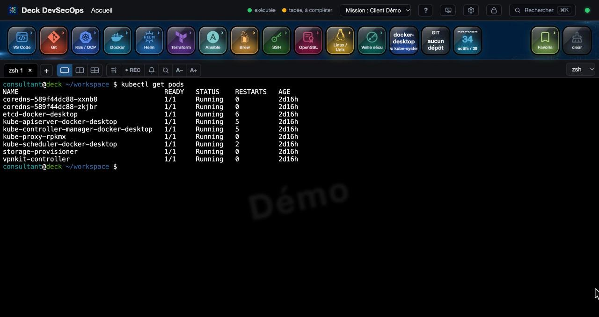
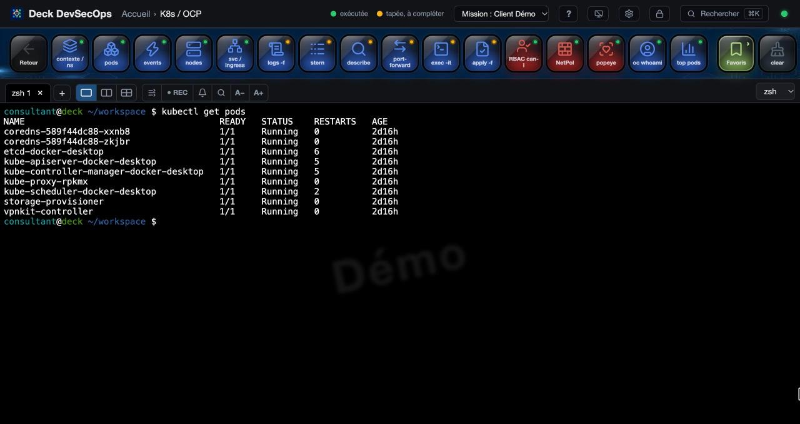
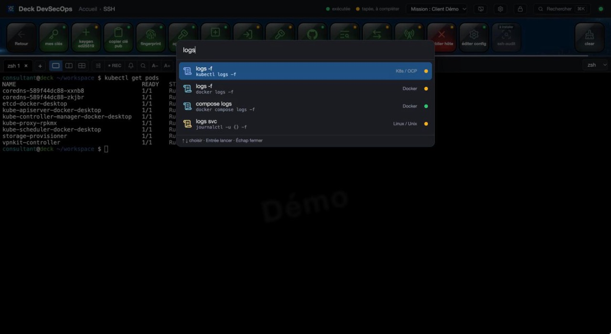

# Accueil et touches

[← Sommaire](README.md)

## L'accueil

- **Une touche par rubrique** : VS Code, Git, Kubernetes / OpenShift, Docker, Helm, Terraform, Ansible, Brew, SSH,
  OpenSSL, Linux / Unix, Veille sécu, Favoris, et tes propres rubriques ([Mes actions](07-mes-actions-et-parametres.md)).
- **Des voyants en direct** à droite : contexte et namespace kubectl (rouge en production), branche Git et fichiers
  modifiés, conteneurs actifs. Un clic sur le voyant kubectl change de contexte ou de namespace ; sur le voyant Git,
  il choisit le dépôt suivi.
- **Favoris** et **clear** sont fixés à droite, sur l'accueil comme dans chaque rubrique (voir [Favoris](06-favoris.md)).
- **clear** efface le terminal actif.
- 18 touches au plus sur l'accueil ; **Réglages › Rubriques** choisit lesquelles et dans quel ordre.

## Les rubriques

Chaque rubrique regroupe les commandes utiles d'un outil. La pastille en haut à droite d'une touche dit ce qu'elle fait :

| Pastille | Signification |
|---|---|
| 🟢 verte | **Exécutée tout de suite** dans le terminal actif |
| 🟠 orange | **Tapée, à compléter** : tu ajoutes un argument puis Entrée |

- **Survol** : infobulle avec la description et la commande exacte.
- **Texte sélectionné** dans le terminal (ou dans une note) : une touche « à compléter » l'insère à la bonne place
  (`{}`), sinon à la fin.
- **Retour automatique** à l'accueil après 60 s sans action dans une rubrique (réglable).
- **Outil absent** : la touche est grisée « à installer » ; un clic tape la commande d'installation (brew, scoop…),
  et la touche se rallume dès que l'outil est installé.

## Palette ⌘K

`⌘K` (ou `Ctrl+K`, ou **Rechercher**) : tape quelques lettres pour trouver et lancer n'importe quelle touche sans
passer par les rubriques. La palette cherche aussi, sans tenir compte des accents :

- tes **favoris** et tes **missions** (Entrée active la mission) ;
- coffre déverrouillé : tes **notes** (titre et contenu) et tes **secrets** (Entrée copie la valeur, effacée du
  presse-papiers après 30 s) ;
- les **commandes récentes** lancées depuis le deck, avec leurs valeurs : Entrée les **tape sans les lancer**.

## Raccourcis

- `⌥1` à `⌥9` (`Alt+1`… sous Windows) : les touches de la page affichée, dans l'ordre.
- `⌘K` palette, `⌘F` recherche dans le terminal, `⌘+` / `⌘−` taille du texte.
- **Épingler** une action de [Mes actions](07-mes-actions-et-parametres.md) la place aussi sur l'accueil.
