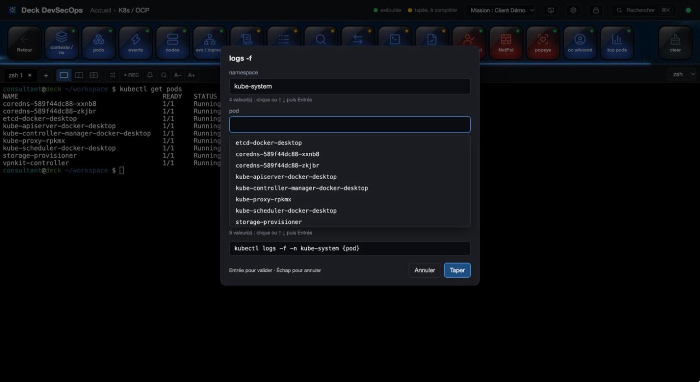
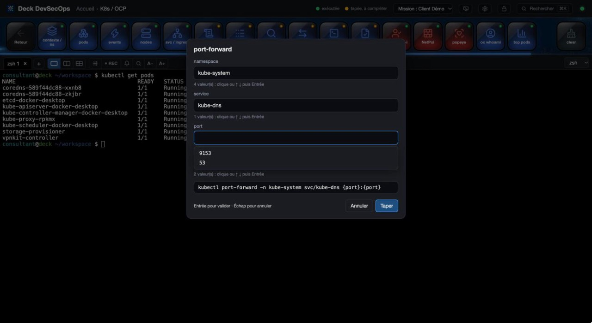
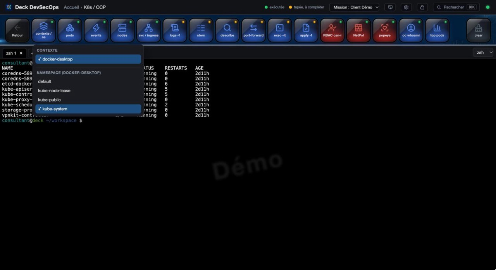
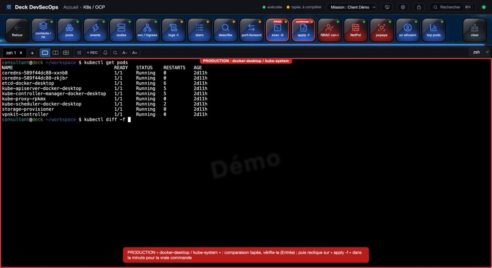

# Kubernetes et production

[← Sommaire](README.md)

## Listes réelles au lieu de copier-coller

Sans texte sélectionné, les touches **logs -f**, **describe**, **exec -it** et **stern** ouvrent une fenêtre qui
propose la **liste réelle** : namespaces, puis les pods du namespace choisi (lus avec `kubectl`). La liste s'ouvre au
clic dans un champ, se filtre pendant la frappe, et se pilote à la souris ou avec ↑ ↓ et Entrée. Un namespace vide
est signalé. Avec un nom sélectionné dans le terminal, la touche l'utilise directement, comme avant.

Même principe côté Docker (**logs -f**, **exec -it**, **inspect** : conteneurs ; **dive** : images).

## port-forward

**port-forward** demande le namespace, le service, puis propose **les ports réels du service** :
`kubectl port-forward -n kube-system svc/kube-dns 9153:9153`. La commande est tapée, à toi de la lancer.

## Contexte et namespace

**contexte / ns** (ou un clic sur le voyant kubectl de l'accueil) liste les contextes de ton kubeconfig et les
namespaces du contexte courant. Choisir un contexte ou un namespace **de production** demande un **second clic** :
la ligne affiche d'abord « ⚠ PRODUCTION : …, clique encore pour confirmer ».

## Garde-fou production

Le contexte est « de production » quand son nom ou son namespace correspond au **motif de production** (`prod|prd`
par défaut, réglable par [mission](08-missions-et-certificats.md)). Alors :

- les terminaux prennent un **bord rouge** et le bandeau **PRODUCTION · contexte / namespace** ;
- le voyant kubectl passe au rouge (**⚠ PROD**) ;
- les touches sensibles (**exec -it**, **apply -f**, **helm upgrade -i**, **rollback**, **uninstall**) affichent
  **PROD** et demandent un **second clic** dans les 5 s.

## Voir avant d'appliquer

En production, **apply -f** (K8s) et **upgrade -i** (Helm) commencent par taper la **comparaison** :
`kubectl diff -f …` ou `helm diff upgrade --install …` (extension [helm-diff](https://github.com/databus23/helm-diff)),
avec ton texte sélectionné. Tu la lances (Entrée) et tu lis ce qui va changer ; **rien n'est appliqué**. Un second
clic **dans la minute** tape la vraie commande, avec la même sélection.
