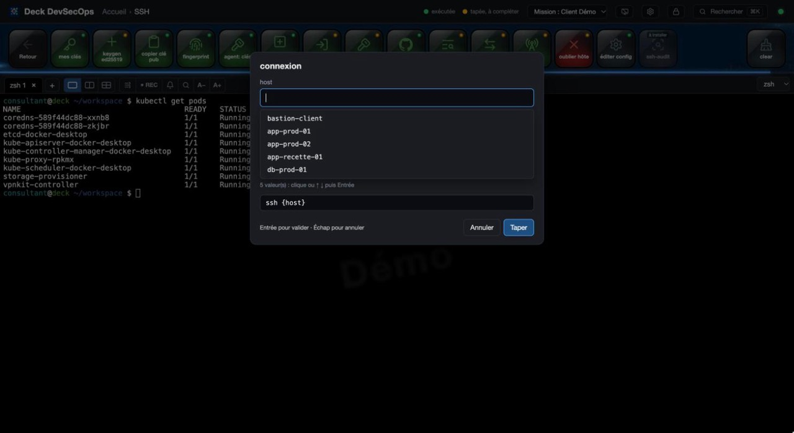

# SSH et serveurs

[← Sommaire](README.md)

## Se connecter

- **connexion** : liste des hôtes de ton `~/.ssh/config` (lignes `Host`, `Include` suivis, motifs comme `Host *`
  ignorés). Le fichier est seulement lu. Tu peux aussi taper une adresse (`user@10.0.0.5`).
- **connexion -i** : choisis d'abord la **clé**, puis l'hôte → `ssh -i <clé> <hôte>`. Les clés privées de `~/.ssh`
  (`%USERPROFILE%\.ssh` sous Windows) sont reconnues par leur `.pub`, un nom classique (`id_ed25519`, `id_rsa`…),
  l'extension `.pem` / `.key`, ou leur en-tête `-----BEGIN … PRIVATE KEY-----` (seule cette première ligne est lue,
  jamais la clé). Les clés PuTTY (`.ppk`) ne sont pas proposées : `ssh -i` ne les lit pas (convertis-les avec
  PuTTYgen, *Export OpenSSH key*).
- **tunnel -L** : hôte, port local, cible et port distant (8080, localhost et 80 pré-remplis).

Si tu utilises toujours la même clé pour un hôte, écris-la une fois dans `~/.ssh/config` (`IdentityFile`) :
**connexion** suffit alors.

## Savoir sur quelle machine on tape

Dès qu'un terminal est connecté en **ssh** (ou **wsl**), le deck affiche la machine :

- **sur l'onglet** : le nom de la **VM de l'inventaire** ([Patchs](13-patchs.md)) si l'hôte y figure, sinon le nom
  de l'hôte ; en **rouge** si la VM est en **production**, en bleu sinon ; au survol, la destination complète ;
- **dans le bandeau** au-dessus du terminal : « SSH · app-prod-01 · production » ;
- **en vue partagée** (2 ou 4 terminaux) : dans l'étiquette du coin de chaque écran (« zsh 2 · web-recette-01 »),
  avec un cadre rouge pour la production.

La VM est reconnue par son hôte (`admin@app-prod-01.client.fr`), son nom d'hôte sans utilisateur, ou son nom
d'inventaire (alias de `~/.ssh/config` du même nom). Seule la destination est lue dans la commande ssh : ni la
clé, ni les options, ni la commande distante. À la déconnexion (`exit`), l'onglet redevient local.

## Les autres touches

Clés (`ssh-keygen`, copier la clé publique, empreinte), agent (`ssh-add`), `ssh -T git@github.com`, `ssh-keyscan`,
oublier un hôte (`ssh-keygen -R`), éditer `~/.ssh/config`, audit (`ssh-audit`).

## Ansible sous Windows

Ansible ne tourne pas sous Windows. La rubrique **Ansible** y est grisée, puis **s'active toute seule** quand le
terminal actif est connecté en **ssh** à une machine Linux / macOS (ou ouvert dans **wsl**).
