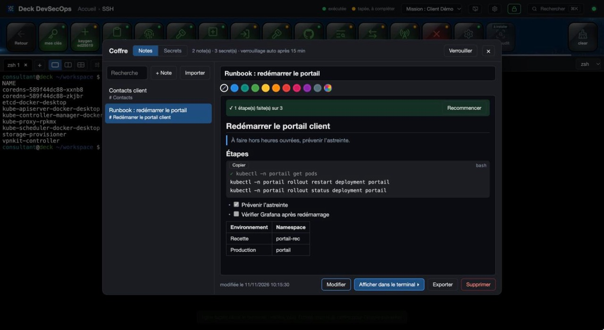
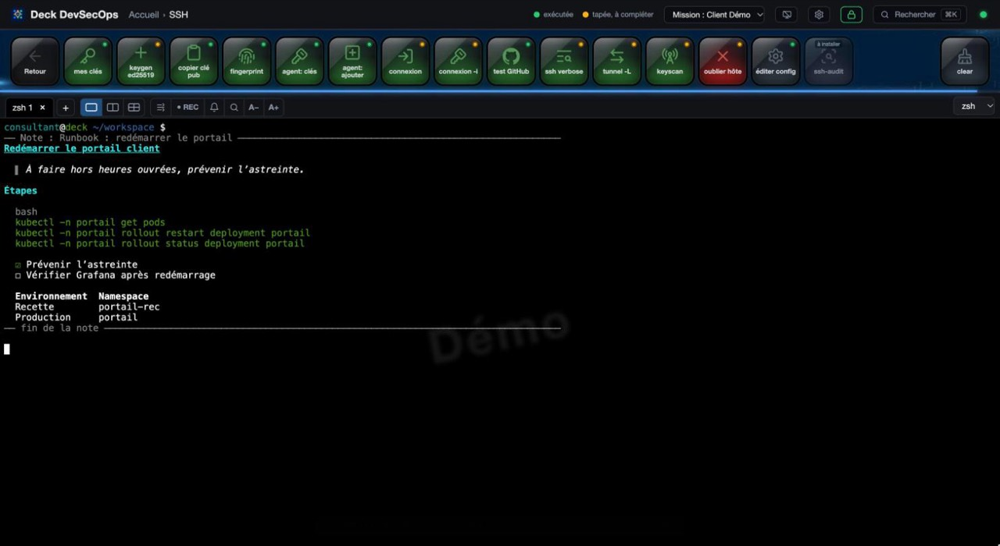
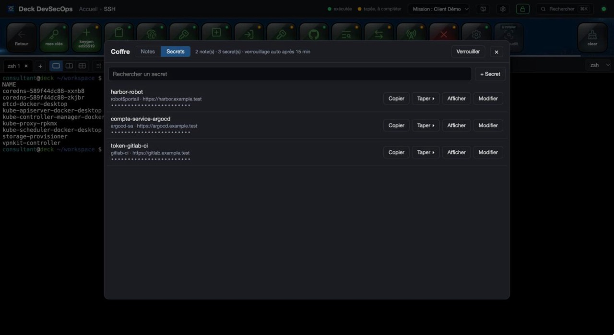
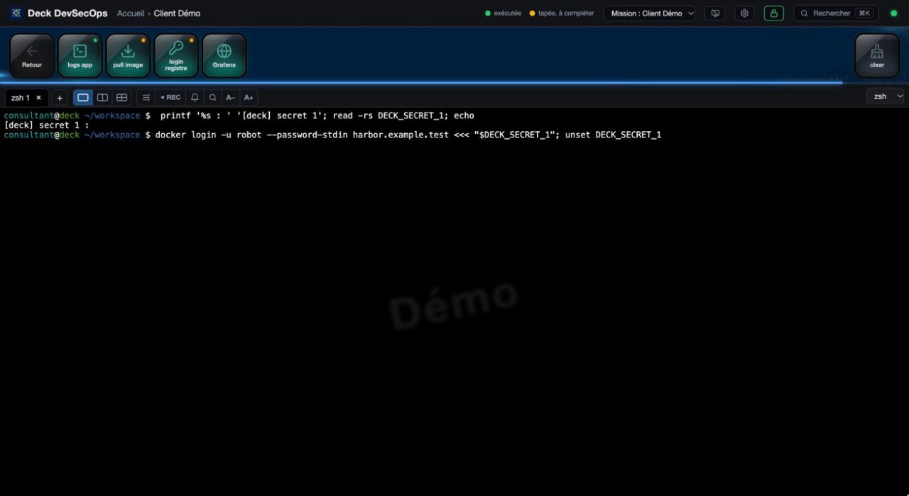

# Coffre : notes et secrets

[← Sommaire](README.md)

Le bouton **cadenas** de l'en-tête (ou « coffre » dans la palette ⌘K) ouvre un coffre **chiffré** (AES-256-GCM, clé
dérivée du mot de passe maître avec scrypt), stocké dans `vault.enc`, hors Git.

- **Création** : au premier usage, un mot de passe maître (8 caractères minimum). **Mot de passe oublié = contenu
  perdu** : aucune récupération possible.
- **Verrouillage automatique** après 15 min sans activité, et au verrouillage de l'écran du poste.

## Notes en Markdown et runbooks



- Titres, listes et cases à cocher, **gras**, `code`, blocs de code, citations, tableaux, liens ; une couleur par note.
- **Aperçu** : chaque **ligne de code est cliquable**, elle est tapée dans le terminal (sans Entrée) et marquée ✓.
  L'avancement du **runbook** est gardé dans le coffre (« 1 étape(s) faite(s) sur 3 ») ; **Recommencer** remet à zéro.
- **Copier** copie tout un bloc de code.
- **Sélection** : du texte sélectionné dans une note est repris par la prochaine touche « à compléter ».



**Afficher dans le terminal ▸** imprime la note mise en forme dans le terminal actif (rien n'est envoyé au shell) :
on y sélectionne un nom de pod ou une commande, puis on clique une touche.

**Exporter** une note crée un fichier `.md` **en clair** (second clic demandé si elle semble contenir un secret) ;
**Importer** ajoute des fichiers `.md` comme notes chiffrées.

## Secrets



- **Nom unique et sans espace** (`harbor-robot`, `token-gitlab-ci`) : dans le formulaire, un espace devient un tiret.
- **Copier** : copié dans le presse-papiers **par le serveur**, effacé après 30 s (la valeur ne passe pas par la page).
- **Taper ▸** : tapé dans le terminal à une invite de mot de passe, sans Entrée.
- **Afficher** : visible quelques secondes.

## Secret dans une commande, sans l'afficher



Dans une commande de [Mes actions](07-mes-actions-et-parametres.md), `{secret:nom}` désigne un secret du coffre :

```text
docker login -u robot --password-stdin {mission.registry} <<< {secret:harbor-robot}
```

Au clic, le shell lit le secret **sans écho** (`read -rs` sous bash / zsh, `Read-Host -AsSecureString` sous
PowerShell, aussi via ssh) : c'est le **serveur** qui lui transmet la valeur, une fois l'invite affichée. La commande
utilise la variable `"$DECK_SECRET_1"`, effacée juste après. La valeur n'apparaît **ni à l'écran, ni dans
l'historique du shell, ni dans le journal, ni dans les enregistrements ● REC**. Refusé sous `cmd` et en mode diffusion.

## Sauvegarder ou déplacer le coffre

**Réglages › Coffre** : **Exporter** (fichier chiffré, illisible sans le mot de passe maître) et **Importer**
(fusionner avec le coffre actuel, ou le remplacer). À la fusion, un secret dont le nom est déjà pris est renommé
`nom-importe`.
