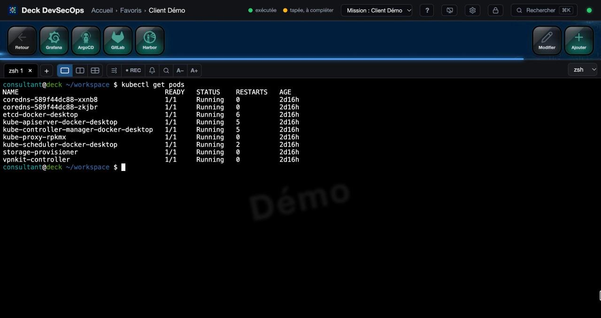

# Favoris

[← Sommaire](README.md)

Tes liens utiles (Grafana, ArgoCD, GitLab, registres, documentation…), ouverts dans un nouvel onglet.

## Toujours à portée de main

La touche **Favoris** est **fixée à gauche de clear**, sur l'accueil et dans chaque rubrique :

1. Depuis une rubrique (Kubernetes, par exemple), un clic sur **Favoris** affiche tes sites (ou directement le groupe
   de la mission active).
2. **Après ton choix**, le site s'ouvre et le deck **revient à la rubrique de départ**.
3. **Sans choix dans les 30 s**, retour automatique à cette rubrique ; la barre sous les touches montre le temps
   restant (« retour à « K8s / OCP » dans … s » au survol). Entrer dans un groupe relance les 30 s.
4. **Retour** depuis le haut des favoris ramène aussi à la rubrique de départ ; le mode **Modifier** met le compte à
   rebours en pause.

- **Ajouter** : nom et adresse (`https://` ajouté si besoin), icône automatique pour les sites connus.
- **Groupes et sous-groupes** (par client, par environnement), avec une couleur ; 12 éléments par niveau.
- **Modifier** : glisser-déposer pour réordonner ou ranger dans un groupe, renommer, supprimer.
- **Mission active** : la touche **Favoris** ouvre directement le groupe de la mission (voir
  [Missions](08-missions-et-certificats.md)).
- Tous les favoris sont trouvables avec la palette **⌘K**.

## Export et import

**Réglages › Favoris** : **Exporter** crée un fichier JSON ; **Importer** fusionne ou remplace. Pratique pour passer
d'un poste à l'autre, ou partager les liens d'une mission avec un collègue. Les favoris (`favoris.json`) restent hors
Git : les adresses d'un client ne partent pas sur le dépôt.
