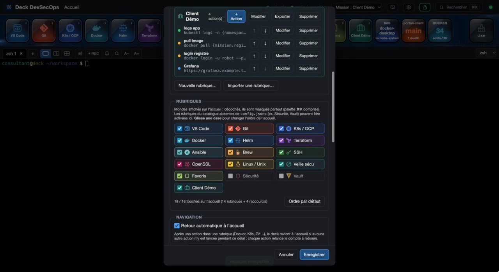
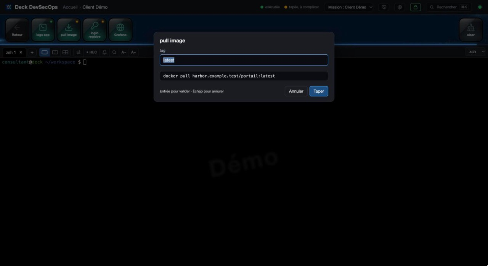

# Mes actions et paramètres

[← Sommaire](README.md)

## Créer ses touches sans toucher au code

**Réglages › Mes actions** : **Nouvelle rubrique…** (nom, icône, couleur), puis **+ Action** :

- une **commande**, exécutée tout de suite ou à compléter (`{}` = texte sélectionné dans le terminal) ;
- ou un **lien** (http ou https).

Chaque action a un nom, une icône (automatique si vide) et une infobulle ; elle peut être **épinglée sur l'accueil**.
Tout est enregistré dans `actions.json`, hors Git, et sauvegardé automatiquement. Une erreur s'affiche dans le
formulaire sans perdre la saisie.

## Paramètres nommés

Une commande peut contenir des paramètres : `kubectl logs -n {namespace} {pod} --since={durée=15m}`. Au clic, une
fenêtre demande chaque valeur, avec l'aperçu de la commande :

- `{nom=valeur}` : **valeur par défaut** pré-remplie ;
- les **dernières valeurs** sont proposées (jamais pour un paramètre sensible : `password`, `token`, `secret`…) ;
- **listes réelles** pour `namespace`, `pod`, `deployment`, `service`, `node`, `context`, `container`, `image`,
  `host` (hôtes SSH), `identity` (clés SSH) et `port` (ports du service choisi) ;
- `{mission.nom}` : **variable de la mission active** (ex. `{mission.registry}` → `harbor.example.test`) ;
- `{secret:nom}` : **secret du coffre**, lu par le shell sans être affiché (voir [Coffre](05-coffre.md#secret-dans-une-commande-sans-lafficher)).

## Partager une rubrique

**Exporter** (sur la rubrique) crée `rubrique-<nom>.json`. Un collègue l'ajoute avec **Importer une rubrique…**,
après avoir vu la liste des commandes (en vert, celles qui s'exécutent dès le clic). Tout est revalidé, rien n'est
épinglé, un nom déjà pris devient « (importée) ». Les `{mission.…}` restent tels quels : chacun utilise les valeurs de
sa propre mission.

## Pour aller plus loin

Les rubriques et raccourcis du catalogue se configurent aussi dans `config.jsonc` (`customSections`,
`customShortcuts`) ; voir le `README.md` à la racine du dépôt.
