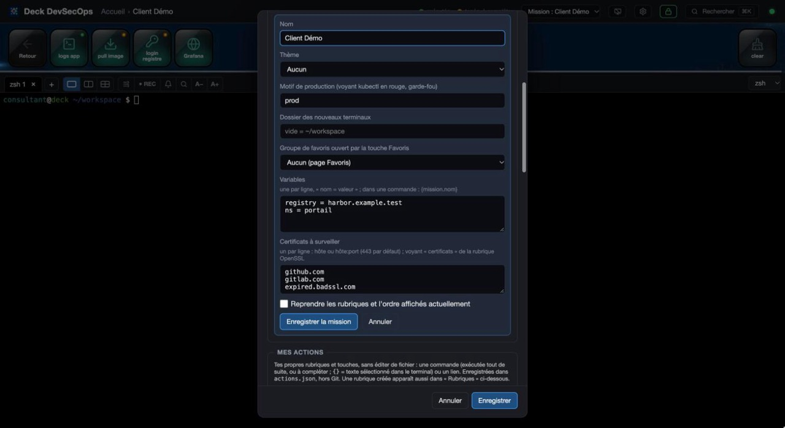

# Missions et certificats

[← Sommaire](README.md)

## Un profil par client



**Réglages › Missions › Nouvelle mission…** enregistre un profil :

- **thème** aux couleurs du client, **rubriques affichées et leur ordre** ;
- **motif de production** (voyant kubectl rouge, garde-fous ; vide = `prodPattern` de `config.jsonc`) ;
- **dossier des nouveaux terminaux** et **groupe de favoris** ouvert par la touche Favoris ;
- **variables** (`registry = harbor.client.fr`), utilisables dans les commandes : `{mission.registry}` ;
- **certificats à surveiller**.

Le sélecteur **Mission** de l'en-tête l'active en un clic. Tant qu'une mission est active, ce que tu changes dans
**Rubriques** et le thème est enregistré dans la mission : la réactiver ne fait pas revenir les anciennes rubriques.
Les missions sont dans `settings.json`, hors Git.

## Surveillance des certificats


Dans la mission, une ligne par certificat : l'adresse (`api.client.fr`, `ldap.client.fr:636` ; une URL complète est
acceptée), puis son **environnement** :

```text
api.client.fr production
portail.client.fr prod
recette-api.client.fr recette
dev-api.client.fr dev
```

Environnements : `production`, `recette`, `qualification`, `développement`, `autre` (abréviations `prod`, `rec`,
`qualif`, `dev` acceptées). **Sans environnement, le certificat est considéré comme de production** : rien n'échappe à
la surveillance la plus stricte.

Les seuils dépendent de l'environnement :

| Environnement | 🟠 orange | 🔴 rouge | Alertes |
|---|---|---|---|
| Production | moins de 30 jours | moins de 7 jours, ou expiré | orange puis rouge |
| Hors production | moins de 14 jours | moins de 3 jours, ou expiré | rouge seulement |

Le voyant **certificats**, première touche de la rubrique **OpenSSL** (ou `cert-status` sur l'accueil via
`config.jsonc`), affiche **le certificat de production le plus urgent** (nom court, jours restants). Un problème
hors production ne change pas sa couleur : il est signalé en bas de la touche (« 1⚠ hors prod »). Les certificats
**injoignables** (expiration inconnue) sont comptés à part : « 6 à vérifier ». Gris : aucun certificat suivi, ou
aucun lisible.

- **Clic** : la liste de tous les certificats en trois parties, **Production**, **Hors production** (avec
  l'environnement de chacun), puis **Injoignables d'ici** (avec la raison en clair). Pour chacun : jours restants,
  date, émetteur, chaîne non reconnue, « en direct » s'il a été lu sans le proxy. En bas : heure de la vérification,
  proxy utilisé, **Vérifier maintenant** et **Calendrier**. Sinon, vérification toutes les 30 min.
- **↗** au bout de chaque ligne (ou clic sur la ligne) : ouvre le site dans le navigateur (`https://hôte`, ou
  `https://hôte:port`). Pas de lien pour les ports qui ne sont pas des sites web (LDAPS 636, IMAPS 993, SMTPS 465…).
- **Alerte** : message dans le deck et notification du système (si autorisée avec la cloche des terminaux), une seule
  fois par seuil ; hors production, seulement au rouge.
- La date est lue par une simple poignée de main TLS (Node, sans openssl, 10 s au plus). Rien d'autre n'est envoyé.

## Poste d'entreprise et proxy

Sur un réseau où toute sortie passe par un proxy (ex. Zscaler) et où le DNS interne ne résout pas les noms publics.
Au bureau avec proxy, à la maison sans : mode **Automatique** de
[Réglages › Proxy](10-reglages-et-tracabilite.md#proxy--bureau-ou-maison).

- définis `HTTPS_PROXY` pour ton utilisateur (`setx HTTPS_PROXY http://proxy:8080` sous Windows), puis redémarre le deck ;
- la vérification passe alors par un tunnel `CONNECT` du proxy ; `NO_PROXY` est respecté ;
- **repli en direct** : si le proxy n'atteint pas un hôte (502, 503, 504, refus, délai), cas des noms **internes**
  de l'entreprise (`*.intra…`) joignables seulement depuis le réseau interne ou le VPN, le deck réessaie **sans le
  proxy** ; le certificat lu ainsi est marqué « en direct », et ce chemin est essayé en premier la fois suivante.
  Si les deux échouent, les deux raisons sont affichées (ex. « par le proxy : 502 ; en direct : nom inconnu du
  DNS ») : hôte hors VPN, nom mal saisi, ou port différent (`hôte:port`) ;
- si le proxy **déchiffre le TLS**, le certificat vu est celui du proxy : la ligne est marquée ⚠ et ne compte pas
  pour la couleur ;
- erreurs distinguées : nom inconnu du DNS, proxy injoignable, refus du proxy (403, 407, 502…), délai dépassé.

Le [diagnostic](10-reglages-et-tracabilite.md#diagnostic) vérifie tout cela en un clic.
