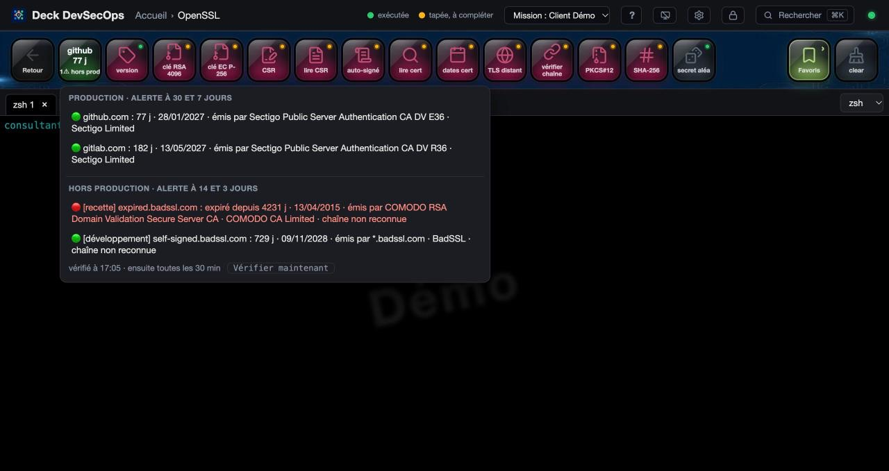

# Missions et certificats

[← Sommaire](README.md)

## Un profil par client


**Réglages › Missions › Nouvelle mission…** enregistre un profil :

- **thème** aux couleurs du client, **rubriques affichées et leur ordre** ;
- **motif de production** (voyant kubectl rouge, garde-fous ; vide = `prodPattern` de `config.jsonc`) ;
- **dossier des nouveaux terminaux** et **groupe de favoris** ouvert par la touche Favoris ;
- **variables** (`registry = harbor.client.fr`), utilisables dans les commandes : `{mission.registry}` ;
- **certificats à surveiller**.

Le sélecteur **Mission** de l'en-tête l'active en un clic. Tant qu'une mission est active, ce que tu changes dans
**Rubriques** et le thème est enregistré dans la mission : la réactiver ne fait pas revenir les anciennes rubriques.
Les missions sont dans `settings.json`, hors Git.

## Surveillance des certificats



Dans la mission, une ligne par certificat : l'adresse (`api.client.fr`, `ldap.client.fr:636` ; une URL complète est
acceptée), puis son **environnement** :

```text
api.client.fr production
portail.client.fr prod
recette-api.client.fr recette
dev-api.client.fr dev
```

Environnements : `production`, `recette`, `qualification`, `développement`, `autre` (abréviations `prod`, `rec`,
`qualif`, `dev` acceptées). **Sans environnement, le certificat est considéré comme de production** : rien n'échappe à
la surveillance la plus stricte.

Les seuils dépendent de l'environnement :

| Environnement | 🟠 orange | 🔴 rouge | Alertes |
|---|---|---|---|
| Production | moins de 30 jours | moins de 7 jours, ou expiré | orange puis rouge |
| Hors production | moins de 14 jours | moins de 3 jours, ou expiré | rouge seulement |

Le voyant **certificats**, première touche de la rubrique **OpenSSL** (ou `cert-status` sur l'accueil via
`config.jsonc`), affiche **le certificat de production le plus urgent** (titre **CERTS PROD**). Un problème hors
production ne change pas sa couleur : il est signalé en bas de la touche (« 1⚠ hors prod »). Gris : aucun certificat
suivi, ou serveurs injoignables.

- **Clic** : la liste de tous les certificats en deux parties, **Production** puis **Hors production** (avec
  l'environnement de chacun), avec les jours restants, la date, l'**émetteur**, une chaîne non reconnue ou un serveur
  injoignable avec la raison en clair, et **Vérifier maintenant**. Sinon, vérification toutes les 30 min.
- **Alerte** : message dans le deck et notification du système (si autorisée avec la cloche des terminaux), une seule
  fois par seuil ; hors production, seulement au rouge.
- La date est lue par une simple poignée de main TLS (Node, sans openssl, 10 s au plus). Rien d'autre n'est envoyé.

## Poste d'entreprise et proxy

Sur un réseau où toute sortie passe par un proxy (ex. Zscaler) et où le DNS interne ne résout pas les noms publics :

- définis `HTTPS_PROXY` pour ton utilisateur (`setx HTTPS_PROXY http://proxy:8080` sous Windows), puis redémarre le deck ;
- la vérification passe alors par un tunnel `CONNECT` du proxy ; `NO_PROXY` est respecté ;
- si le proxy **déchiffre le TLS**, le certificat vu est celui du proxy : la ligne est marquée ⚠ et ne compte pas
  pour la couleur ;
- erreurs distinguées : nom inconnu du DNS, proxy injoignable, refus du proxy (403, 407, 502…), délai dépassé.

Le [diagnostic](10-reglages-et-tracabilite.md#diagnostic) vérifie tout cela en un clic.
