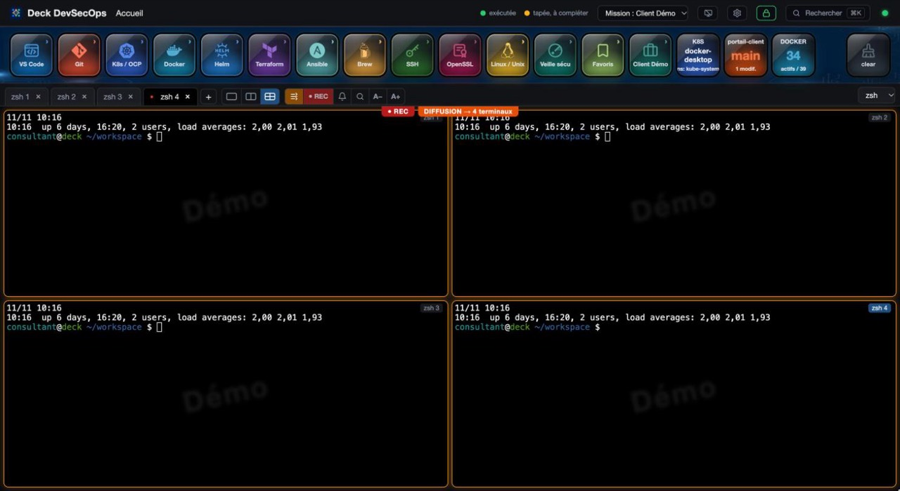
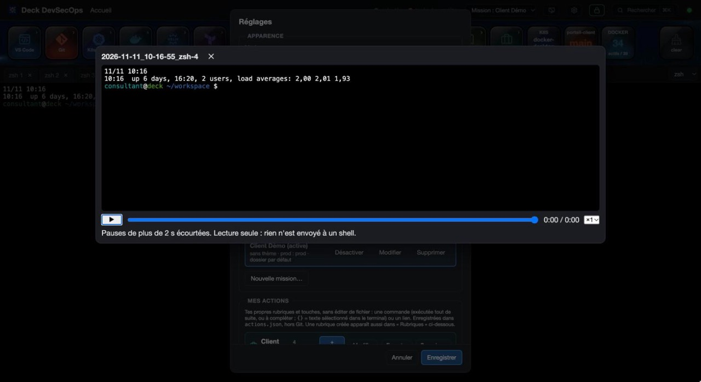

# Terminaux

[← Sommaire](README.md)

Les terminaux sont de vrais shells de ton poste (zsh, bash, PowerShell, Git Bash, cmd), affichés avec xterm.js.

## Onglets et disposition

- **+** ouvre un terminal (shell choisi à droite) ; double-clic sur un onglet pour le **renommer** ; glisser pour
  réordonner. Les terminaux sont rouverts après un redémarrage du deck.
- Disposition : **1**, **2×1** (côte à côte) ou **2×2** ; l'actif reçoit les touches.
- **Recherche** (`⌘F`), **taille du texte** (`A−` / `A+`), **notification** quand une commande longue se termine
  (cloche).
- Liens cliquables, copier-coller habituel, signature en filigrane (réglable).

## Diffusion

Le bouton **diffusion** (lignes et flèches) envoie ta frappe, et les touches du deck, à **tous les terminaux visibles** :
pratique pour lancer la même vérification sur plusieurs serveurs. Les terminaux sont entourés d'orange et le bandeau
**DIFFUSION → n terminaux** le rappelle.

## Enregistrer une session (● REC)

**● REC** enregistre tout ce qui s'affiche dans le terminal actif (preuve d'intervention, compte rendu) ; point rouge
sur l'onglet et bandeau **● REC** ; re-cliquer pour arrêter (arrêt automatique à la fermeture du terminal ou à 50 Mo).

- Deux fichiers horodatés dans `.deck-recordings/` (hors Git) : `.cast` (rejouable avec `asciinema play`) et `.txt`
  (texte sans couleurs, prêt pour un rapport).
- Seul ce qui **s'affiche** est enregistré : un mot de passe tapé à une invite (non affiché) n'y figure pas, ni les
  notes du coffre affichées par le deck.

## Rejouer une session

**Réglages › Enregistrements de sessions** : **▶** rejoue la session dans le deck, en lecture seule. Lecture / pause
(Espace), barre de progression, vitesse ×1 à ×8, pauses de plus de 2 s écourtées. **Ouvrir le dossier** donne accès
aux fichiers.
