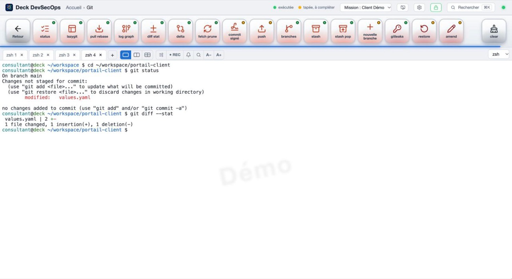
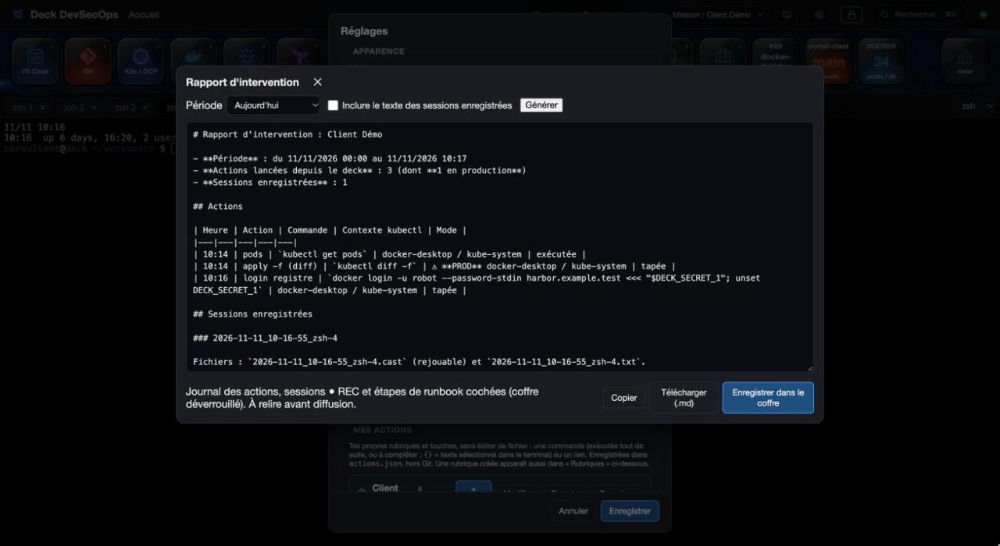
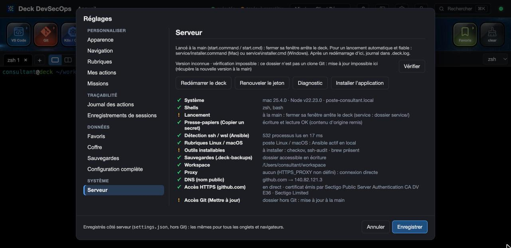
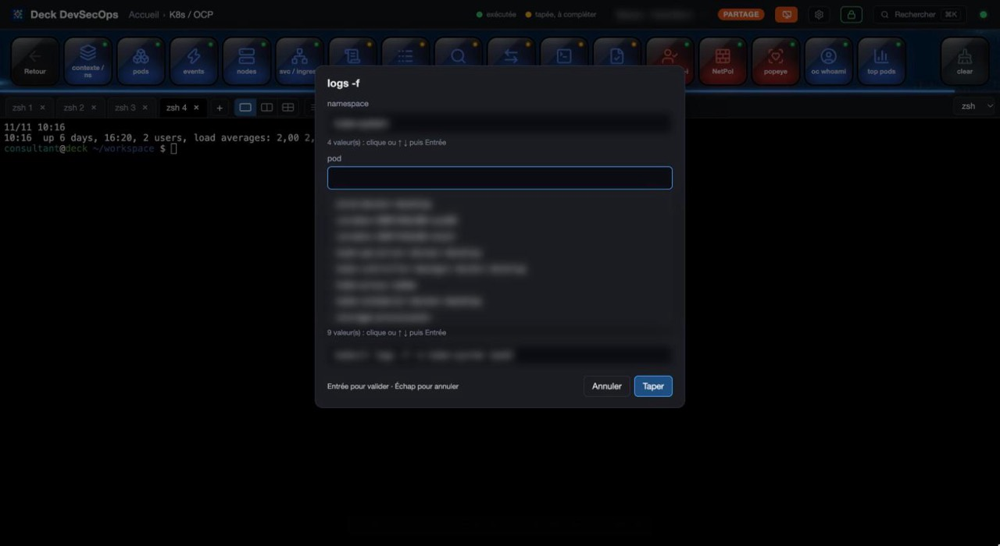

# Réglages et traçabilité

[← Sommaire](README.md)

La **roue dentée** de l'en-tête ouvre les Réglages.

Une section à la fois : le **menu de gauche** les regroupe en quatre parties, et le contenu défile à droite.

| Partie | Sections |
|---|---|
| Personnaliser | Apparence, Navigation, Rubriques, Mes actions, Missions |
| Traçabilité | Journal des actions (et rapport d'intervention), Enregistrements de sessions |
| Données | Favoris, Coffre, Sauvegardes, Configuration complète |
| Système | Serveur (mise à jour, diagnostic, application) |

Le panneau se rouvre sur la dernière section consultée. **Annuler** et **Enregistrer** restent visibles en bas, quelle
que soit la section ; **Enregistrer** enregistre toutes les sections d'un coup. Un champ invalide dans une autre section
(ex. délai de retour à l'accueil) l'affiche automatiquement. Sur un écran étroit, le menu passe en haut.

## Apparence

- Mode **sombre**, **clair** ou **système**.
- **Thème de mission** aux couleurs d'un client (en-tête, barre des touches).
- **Signature des terminaux** : texte ou image en filigrane, au fond de chaque terminal.

## Rubriques et navigation

- **Rubriques** : cocher celles de l'accueil, glisser pour l'ordre (18 touches au plus).
- **Retour automatique à l'accueil** après une action, avec un délai réglable.

## Journal des actions

Chaque action lancée depuis le deck est notée : date, touche, commande (exécutée ou tapée), terminal, contexte kubectl
(en rouge si production). Les commandes tapées à la main et les valeurs du coffre ne sont pas notées.
**Exporter (CSV)** pour Excel. Fichier `.deck-journal.jsonl`, hors Git.

## Rapport d'intervention

**Rapport d'intervention…** assemble un compte rendu Markdown d'une période (aujourd'hui, 4 h, depuis hier, 7 jours,
ou depuis une date) :

- les actions du journal, avec **⚠ PROD** quand c'était la production ;
- les sessions **● REC** (texte inclus sur demande) ;
- les étapes de runbook cochées (coffre déverrouillé) ;
- les **patchs réalisés** sur la période et l'**état du parc à date** (certificats et VMs par environnement), voir
  [Échéances et synthèse](14-echeances-et-synthese.md#rapport-dintervention-enrichi).

Tu le relis et le modifies, puis **Copier**, **Télécharger (.md)** ou **Enregistrer dans le coffre**. Rien n'est
envoyé ailleurs.

## Sauvegardes

Avant chaque modification des favoris, de Mes actions, des réglages ou du coffre, une copie est gardée dans
`.deck-backups/` (10 par fichier). **Restaurer** sauvegarde d'abord la version actuelle.

## Configuration complète et mise à jour

- **Configuration complète** : export / import en un fichier de tes favoris, Mes actions, réglages, missions,
  [patchs des VMs](13-patchs.md) et signature (le coffre s'exporte à part, chiffré). Idéal pour passer de ton Mac à ton PC.
- **Mettre à jour** (Réglages › Serveur) : compare avec GitHub, fait `git pull`, installe les dépendances si besoin et
  redémarre. Refusé si des fichiers suivis ont été modifiés sur la machine, pour ne rien écraser.

## Diagnostic

**Réglages › Serveur › Diagnostic** vérifie ce qui dépend du poste : presse-papiers, détection ssh / wsl, outils à
installer, sauvegardes, shells, lancement en service, et **réseau** : proxy (`HTTPS_PROXY`, identifiants masqués),
DNS d'un nom public, accès HTTPS (direct ou via le proxy, interception TLS signalée), accès Git pour **Mettre à jour**.

## Mode partage d'écran

Avant une réunion ou une démo, le bouton **écran barré** de l'en-tête (pastille **PARTAGE**) floute ce qui révèle
l'infrastructure d'un client : contexte kubectl et voyants, mission, notes, secrets, listes d'hôtes et de pods,
sélecteurs, palette, réglages sensibles, rapport, lecteur. **Survoler une zone l'affiche** ; le terminal reste visible.
