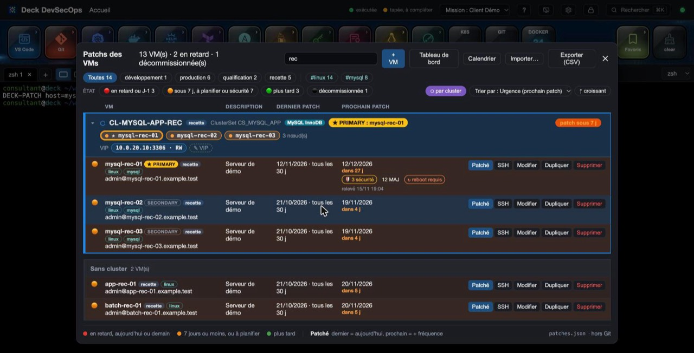
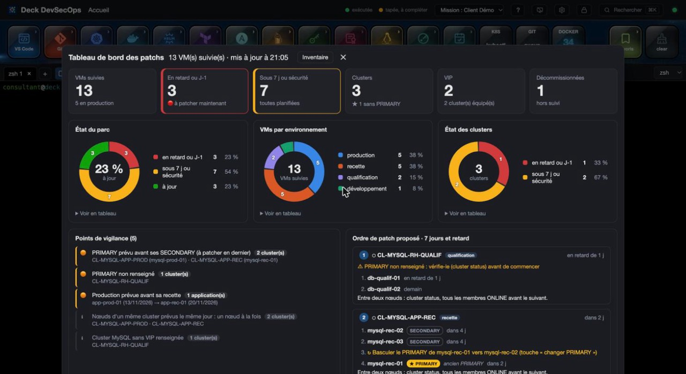
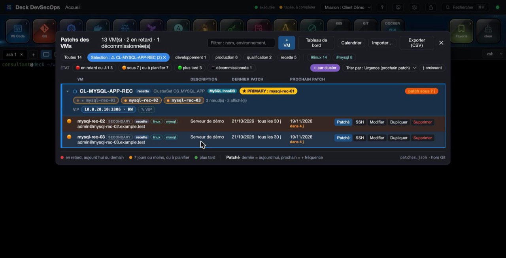
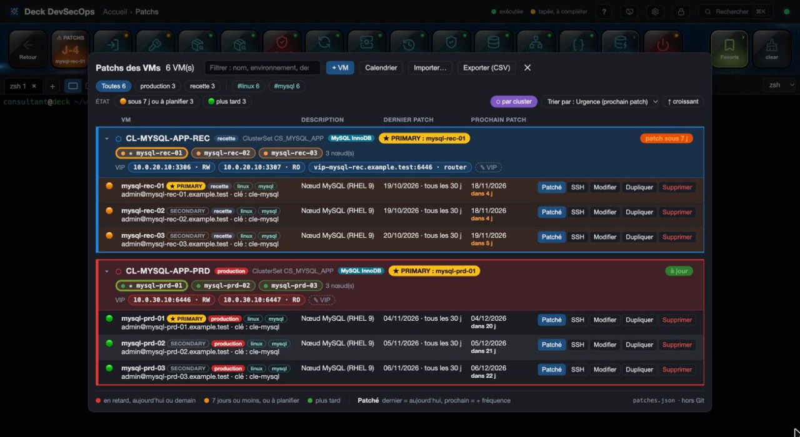
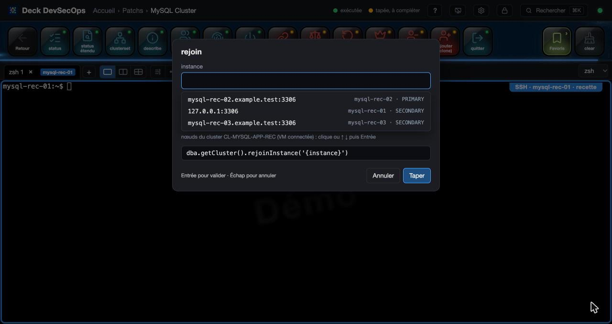

# Patchs des VMs

[← Sommaire](README.md)

Un inventaire de tes VMs avec leurs dates de patch, et un voyant qui t'alerte avant qu'une machine ne prenne du retard.

## La rubrique Patchs

Active-la dans **Réglages › Rubriques** (case **Patchs**). Elle contient :

- le **voyant patchs** (première touche) : le délai de la VM la plus urgente en gros (**J-3** = dans 3 jours, **J** =
  aujourd'hui, **J+2** = 2 jours de retard) et son nom en bas ; un clic ouvre l'inventaire ;
- **ssh VM** : choisis la VM dans la liste ;
- **ssh -i VM** : choisis la VM, sa **clé** est reprise de l'inventaire (sinon choisis-la parmi tes clés privées de
  `~/.ssh`) → `ssh -i <clé> <hôte>` ;
- **relevé patch** / **relevé Windows** : l'état réel de la VM connectée (dernier patch, mises à jour, sécurité,
  redémarrage), qui met l'inventaire à jour, voir [Relevé patch](#relevé-patch--létat-réel-de-la-vm) ;
- **vérifs VM** : la sous-page des vérifications détaillées à lancer **sur la VM** (après le ssh ; le relevé les
  résume) : mises à jour en attente (**MAJ (apt)**, **MAJ (dnf)**), **sécurité seule**, **reboot requis ?**, **noyau
  et boot**, **historique** des derniers paquets ; sous Windows, elles s'activent une fois le terminal connecté en ssh ;
- **redémarrer** : redémarre la VM dans 1 min (tapée, à valider) ;
- **correctifs Windows** : les 10 derniers KB installés (PowerShell) ;
- **MySQL InnoDB Cluster**, depuis un terminal connecté à un nœud du cluster (lecture seule, mysqlsh demande le mot
  de passe root dans le terminal ; le deck ne le voit pas) :
  - **cluster status** : `` mysqlsh root@`hostname` -- cluster status `` (état des nœuds, PRIMARY / SECONDARY,
    quorum) ;
  - **clusterset status** : `` mysqlsh root@`hostname` -- clusterset status --extended=1 ``, à utiliser quand
    `cluster status` échoue parce que le ClusterSet n'est pas ONLINE ;
  - **mysqlsh (JS)** : `` mysqlsh root@`hostname` --js ``, le shell interactif en **mode JavaScript**, celui qu'il faut
    pour `dba.getCluster()`, `forceQuorumUsingPartitionOf()`, `rejoinInstance()`, `rebootClusterFromCompleteOutage()`
    (en mode SQL, erreur de syntaxe) ;
  - **MySQL Cluster** : la sous-page des commandes à lancer **dans** cette session JS, voir ci-dessous.

| Couleur du voyant | Signification |
|---|---|
| 🟢 vert | prochain patch dans plus de 7 jours |
| 🟠 orange | dans 7 jours ou moins, date à planifier, ou mises à jour de sécurité en attente (relevé) |
| 🔴 rouge | demain, aujourd'hui, ou **en retard** |

**Alertes** : comme pour les certificats, un message dans le deck et une notification du système (si autorisée avec la
cloche des terminaux) quand une VM passe à l'orange puis au rouge, une seule fois par seuil.

Dans ces listes (et dans toutes les touches qui demandent un hôte, rubrique SSH comprise), **les VMs de
l'inventaire viennent en tête**, par ordre alphabétique, avec leur nom et leur environnement à droite ; ensuite les
hôtes de `~/.ssh/config`. Tape quelques lettres (nom de VM, hôte ou environnement) pour filtrer.

## Relevé patch : l'état réel de la VM

Plutôt que de cliquer **Patché** à la main, fais le relevé sur la VM : connecte-toi en ssh (bastion compris), puis
touche **relevé patch** (rubrique Patchs). Elle lance une commande **en lecture seule, sans sudo**, qui lit sur la VM :

| | RHEL / Rocky (dnf, yum) | Debian / Ubuntu (apt) |
|---|---|---|
| Dernier patch | date du dernier paquet installé (`rpm -qa --last`) | dernière modification des paquets (`/var/lib/dpkg/status`) |
| Mises à jour en attente | `dnf check-update` | `apt list --upgradable` |
| Dont sécurité | `dnf updateinfo list --security` | paquets venant de `-security` |
| Redémarrage requis | `needs-restarting -r` | `/var/run/reboot-required` |

Elle affiche une ligne `DECK-PATCH host=… last=… pending=… security=… reboot=…`, que le deck lit dans la sortie du
terminal. Il met alors à jour **la VM à laquelle le terminal est connecté** (le cadre de couleur ; sinon, la VM dont le
nom correspond au nom d'hôte renvoyé) :

- **dernier patch** = la date lue sur la VM, **prochain patch** recalculé avec la fréquence ; tu patches, tu
  redémarres, tu refais le relevé : plus besoin de **Patché** ;
- **badges** sous la date : « 🛡 3 sécurité », « 12 MAJ », « ↻ reboot requis » ou « ✓ à jour », et l'heure du relevé ;
- **mises à jour de sécurité en attente = VM en orange**, même si son prochain patch est loin : voyant (« sécu »),
  alertes, filtre d'état, tableau de bord et ordre de patch en tiennent compte ;
- **redémarrage requis** : badge et point de vigilance, sans changer la couleur ;
- une ligne dans le **journal** (et donc le rapport d'intervention).

**relevé Windows** fait de même sur un serveur Windows, dans une session PowerShell : date du dernier correctif (KB)
et redémarrage requis (le nombre de mises à jour en attente n'est pas relevé).

Le deck ne se connecte jamais seul à la VM et n'y envoie rien : c'est ton terminal qui lance la commande, le deck ne
fait que lire la ligne repère. La commande imprime `DECK-%s … PATCH` : son propre texte, affiché à la frappe, n'est
jamais pris pour un résultat.

## L'inventaire

Les VMs sont triées de la plus urgente à la moins urgente, avec leur environnement (production en rouge), leurs
**tags**, leur description, le dernier et le prochain patch.

Lignes en **couleurs alternées**, ligne survolée surlignée en bleu, et un **liseré rouge ou orange** à gauche des VMs
urgentes.

**Filtres** (sous l'en-tête), avec le nombre de VMs sur chaque bouton :

- **environnement** (un à la fois) et **tags** (ils se **combinent** : **production** + **#critique**) ;
- **État** : 🔴 en retard ou J-1, 🟠 sous 7 j ou à planifier, 🟢 plus tard, ⚫ décommissionnée (un à la fois ;
  seuls les états présents sont proposés) ;
- le champ **Filtrer** cherche en plus dans le nom, l'hôte, la description et les tags.

Tous se combinent ; re-cliquer retire un filtre, **Toutes** les retire tous.

**Tri** : menu **Trier par** (urgence, nom, environnement, dernier patch, prochain patch) et bouton **↑ croissant / ↓ décroissant** ; ou clic sur les titres **VM**, **Dernier patch**,
**Prochain patch** (re-clic : ordre inversé, flèche sur la colonne triée). Le tri choisi est retenu.

Pour chaque VM :

- **Patché** : le dernier patch devient aujourd'hui et le prochain est recalculé avec la fréquence (ex. tous les 30 j) ;
  l'action est notée dans le [journal](10-reglages-et-tracabilite.md#journal-des-actions) ;
- **SSH** : tape `ssh <hôte>` dans le terminal (sans Entrée), ou `ssh -i <clé> <hôte>` si une clé est renseignée pour
  la VM (affichée sous son nom : « clé : … ») ;
- **Dupliquer** : une nouvelle VM pré-remplie à partir de celle-ci (hôte, clé, environnement, tags, dates, fréquence,
  description), avec le **nom suivant libre** (`app-prod-01` → `app-prod-02`, ou `-03` si `-02` existe) ; le nom est
  aussi remplacé dans l'hôte (`admin@app-prod-01.client.fr` → `admin@app-prod-02.client.fr`). Vérifie l'hôte et les
  dates avant d'enregistrer ;
- **Modifier**, **Supprimer** (deux clics).

**Calendrier** (en-tête) : les échéances du mois et l'export vers Outlook, voir
[Échéances et synthèse](14-echeances-et-synthese.md).

## Tableau de bord

**Tableau de bord** (en-tête de l'inventaire, ou ⌘K › « Tableau de bord des patchs ») : une vue d'ensemble, mise à
jour en direct, des VMs suivies (les décommissionnées sont comptées à part) :

- **chiffres clés** : VMs suivies (dont production), en retard ou J-1, sous 7 jours (et sans date), clusters (et ceux
  sans PRIMARY), VIP, décommissionnées ;
- **trois anneaux** (camemberts évidés) pour voir la répartition d'un coup d'œil : **état du parc** (en retard ou J-1,
  sous 7 jours, à planifier, à jour ; au centre, le pourcentage à jour), **VMs par environnement** (couleur fixe par
  environnement) et **état des clusters** (état le plus urgent de chaque cluster). Nombre sur les parts, légende avec
  nombre et pourcentage, détail au survol, **Voir en tableau** ;
- **patch par environnement** : une barre par environnement, découpée par statut (en retard ou J-1, sous 7 jours, à
  planifier, à jour), avec la légende, le nombre dans chaque segment, le détail au survol (les VMs concernées) et
  **Voir en tableau** pour les chiffres ;
- **prochains patchs sur 8 semaines** : nombre de VMs à patcher par semaine (détail au survol), plus le rappel du
  retard et des VMs sans date ;
- **clusters** : environnement, carte des nœuds (couleur du statut, cercle doré pour le PRIMARY, pointillés pour un
  nœud décommissionné), nœuds, PRIMARY, VIP et état du cluster ;
- **tags les plus fréquents** ;
- **points de vigilance** et **ordre de patch proposé** (ci-dessous).

**Tout est cliquable** : une tuile, un segment de barre, un environnement, une semaine, un cluster, un tag ou un point
de vigilance ouvre l'**inventaire filtré sur ses VMs**, avec un filtre **Sélection** (ex. « Sélection :
⚠ CL-MYSQL-APP-REC (2) ») qu'on retire avec ✕ ou **Toutes**. Au clavier : Tab puis Entrée.

**Inventaire** (en-tête) revient à la liste des VMs.

### Points de vigilance

Ce qui peut mal tourner pendant une campagne, **regroupé par type** : une ligne par type, avec le nombre de clusters
(ou de VMs) concernés, les premiers en clair et tous au survol ; un clic ouvre toutes leurs VMs dans l'inventaire.
Du plus grave au moins grave (🟠 puis ℹ) :

- 🟠 **la production prévue avant sa recette** : rapprochées par le nom, sans les mots d'environnement (`app-prod-01`
  et `app-rec-01`, `CL-MYSQL-APP-PROD` et `CL-MYSQL-APP-REC`) ;
- 🟠 **le PRIMARY prévu avant ses SECONDARY** : il se patche en dernier ;
- 🟠 **PRIMARY non renseigné** dans un cluster de plusieurs nœuds ;
- ℹ **nœuds d'un même cluster prévus le même jour** : normal pour une fenêtre de maintenance, à condition de patcher un
  nœud à la fois ;
- ℹ **cluster MySQL sans VIP** renseignée ;
- ℹ **redémarrage requis** d'après le [relevé](#relevé-patch--létat-réel-de-la-vm).

Le retard n'est pas un point de vigilance : il est déjà dans les chiffres, les anneaux et l'ordre de patch.

### Ordre de patch proposé

Pour les VMs **en retard ou dues dans les 7 jours**, l'ordre à suivre, numéroté :

- **la recette avant la production** : développement, qualification, recette, puis production ; dans un même
  environnement, le plus urgent d'abord ;
- **un cluster = un bloc**, avec tous ses nœuds suivis (ils se patchent ensemble ; ceux qui ne sont pas encore dus
  sont en gris) : **les SECONDARY d'abord**, un nœud à la fois, puis **↻ bascule du PRIMARY** vers un nœud déjà patché
  (touche **changer PRIMARY** de [MySQL Cluster](#mysql-cluster--les-commandes-de-la-session-js)), et **l'ancien
  PRIMARY en dernier** ; rappel « cluster status » entre deux nœuds ;
- PRIMARY non renseigné : signalé en tête du bloc, à vérifier avant de commencer.

**Copier le plan (Markdown)** le met dans le presse-papiers pour une demande de changement, un mail ou un ticket
(étapes numérotées, commande de bascule ; texte en français). Un clic sur un bloc ouvre ses VMs dans l'inventaire.

## Clusters (MySQL InnoDB Cluster…)

Les nœuds d'un même cluster se patchent ensemble, et pas n'importe comment : un nœud à la fois, jamais deux
environnements en même temps. Pour chaque VM, trois champs facultatifs :

- **Cluster** : le nom du cluster (ex. `CL-MYSQL-APP-REC`) ; les clusters déjà saisis sont proposés ;
- **ClusterSet** : l'ensemble qui contient le cluster (MySQL InnoDB ClusterSet) ;
- **Profil** : *standard* ou **MySQL InnoDB Cluster** (étiquette « MySQL InnoDB » ; base des futurs contrôles propres
  à MySQL) ;
- **Rôle dans le cluster** : **PRIMARY** ou **SECONDARY** (renseigné à la main). **Un seul PRIMARY par cluster** :
  désigner un nouveau PRIMARY (après une bascule, un `forceQuorum`…) repasse l'ancien en SECONDARY, avec un message.

Le PRIMARY est mis en avant : badge doré **★ PRIMARY** sur sa ligne, **en tête** de son cluster, étoile et cercle doré
sur la carte des nœuds, et rappelé dans l'en-tête (« ★ PRIMARY : mysql-rec-02 ») ; « PRIMARY non renseigné » sinon.
C'est le nœud à patcher **en dernier**.

**⬡ par cluster** (à côté du tri) regroupe l'inventaire en **blocs**, un par cluster, encadrés aux couleurs de
l'environnement (production rouge, recette bleu, qualification ambre, développement vert) :

- **en-tête** : nom du cluster, environnement, ClusterSet, profil, et l'état le plus urgent du cluster ;
- **carte des nœuds** : une pastille par nœud, colorée selon son patch (🔴 en retard ou J-1, 🟠 sous 7 j, 🟢 plus
  tard ; détail au survol), ★ pour le PRIMARY, grisée pour un nœud décommissionné ; le nombre de nœuds ;
- **clic sur l'en-tête** : replier le cluster (en-tête et carte seuls) ou le déplier ; retenu ;
- les nœuds dessous, triés selon le tri choisi ; les VMs sans cluster à la fin. Hors regroupement, le cluster et le profil s'affichent sous le
nom de la VM. Le champ **Filtrer** cherche aussi dans le cluster et le ClusterSet.

**Dupliquer** un nœud garde son cluster, son ClusterSet et son profil (la copie est SECONDARY) : pratique pour ajouter le nœud suivant
(`mysql-rec-03` → `mysql-rec-04`).

## VIP d'un cluster

Chaque cluster peut avoir ses **VIP** (adresse virtuelle du routeur MySQL, de keepalived…), affichées dans l'en-tête de
son bloc (vue **⬡ par cluster**), aux couleurs de l'environnement :

- **✎ VIP** : une VIP par ligne, `adresse[:port] [libellé]` : `10.0.0.10:3306 RW`, `10.0.0.10:3307 RO`,
  `vip-mysql-app.example.test:6446 router` ; 10 au plus par cluster ; adresse IP (v4 ou v6) ou nom d'hôte, sans
  caractère de shell ; vider la liste retire les VIP ;
- **clic sur une VIP** : tape `nc -zv <adresse> <port>` dans le terminal actif, **sans Entrée** : test de connectivité,
  depuis le poste ou depuis un terminal connecté à un bastion ou à une VM ;
- le champ **Filtrer** cherche aussi dans les adresses des VIP (taper `10.0.30` montre les nœuds du cluster).

Les VIP sont enregistrées dans `patches.json` (hors Git) et incluses dans l'export de la **configuration complète** ;
elles ne sont pas dans le CSV (une ligne par VM).

## VM décommissionnée

Une VM retirée du service reste **dans l'inventaire**, pour garder sa trace, mais sort du suivi. **Modifier › VM
décommissionnée** (case à cocher), ou colonne CSV `decom` (`oui`, `oui 14/11/2026`, `x`…) :

- la ligne est **grisée**, le nom barré, avec un badge « DÉCOMMISSIONNÉE le 14/11/2026 » ; elle passe **en fin de
  liste** ; « hors suivi » au lieu de la date de patch ;
- elle ne compte plus pour le **voyant** et les **alertes**, le **calendrier** et l'export Outlook, la **synthèse**,
  ni dans les listes de connexion (**ssh VM**, nœuds MySQL) ;
- si c'était le **PRIMARY**, elle perd ce rôle ;
- ses boutons deviennent **Remettre en service** (retour dans le suivi), **Modifier** et **Supprimer** ;
- filtre d'état **⚫ décommissionnée** ; l'en-tête de l'inventaire compte les VMs suivies et les décommissionnées.

**Cluster** : un nœud décommissionné est grisé et barré sur la carte des nœuds et ne compte plus dans l'état du
cluster (« 3 nœuds dont 1 décommissionné ») ; quand **tous** les nœuds le sont, le cluster passe **au gris**
(« cluster décommissionné ») et descend en fin de liste.

## MySQL Cluster : les commandes de la session JS

**Patchs › MySQL Cluster** regroupe les commandes à taper **dans une session `mysqlsh --js`** (ouverte avec la touche
**mysqlsh (JS)** sur un nœud). Le deck ne voit pas que le terminal est dans mysqlsh (il tourne sur la VM) : ouvre
d'abord la session, puis utilise ces touches.

| Touche | Commande | |
|---|---|---|
| **status** | `dba.getCluster().status()` | lecture |
| **status étendu** | `dba.getCluster().status({extended: 1})` | lecture |
| **clusterset** | `dba.getClusterSet().status({extended: 1})` (si status échoue : ClusterSet non ONLINE) | lecture |
| **describe** | `dba.getCluster().describe()` | lecture |
| **membres GR** | `session.runSql("SELECT MEMBER_HOST, MEMBER_STATE, MEMBER_ROLE FROM performance_schema.replication_group_members")` | lecture |
| **GTID** | `session.runSql("SELECT @@hostname, @@gtid_executed")` (avant de forcer le quorum) | lecture |
| **start_on_boot** | `session.runSql("SELECT @@group_replication_start_on_boot")` | lecture |
| **rejoin** | `dba.getCluster().rejoinInstance('<nœud>')` | ⚠ action |
| **forcer quorum** | `dba.getCluster().forceQuorumUsingPartitionOf('<nœud>')` (perte de quorum) | ⚠ action |
| **reboot outage** | `dba.rebootClusterFromCompleteOutage()` (panne totale) | ⚠ action |
| **changer PRIMARY** | `dba.getCluster().setPrimaryInstance('<nœud>')` (ex. avant de patcher le PRIMARY) | ⚠ action |
| **retirer nœud** | `dba.getCluster().removeInstance('<nœud>', {force: true})` (rejoin refusé, GTID errants) | ⚠ action |
| **ajouter (clone)** | `dba.getCluster().addInstance('<nœud>', {recoveryMethod: 'clone'})` | ⚠ action |
| **quitter** | `\q` | |

- **Lecture** (pastille verte) : lancées tout de suite ; `session.runSql(…)` évite de passer en `\sql`.
- **Actions** (rouge, pastille orange) : **tapées sans Entrée** : tu relis, tu complètes, tu valides.
- **Le nœud** (`<nœud>`) se choisit dans une liste : les nœuds **du cluster de la VM connectée** dans le terminal actif
  (inventaire), au format `hôte:3306`, PRIMARY en tête, rôle affiché ; sinon tous les nœuds MySQL de l'inventaire,
  ou saisie libre.

Après un **changer PRIMARY** ou un **forcer quorum**, mets à jour le rôle dans l'inventaire (**Modifier › Rôle**) :
le deck ne le détecte pas seul.

## Ajouter une VM

**+ VM** : nom (unique), hôte SSH (facultatif : le nom par défaut, ou `admin@10.0.0.5`), **clé SSH** (facultatif :
chemin de la clé privée pour `ssh -i`, tes clés de `~/.ssh` sont proposées ; caractères de shell refusés), environnement,
**tags** (facultatif, séparés par des virgules : `linux, dmz, critique` ; en minuscules, 10 au plus, les tags déjà
utilisés sont proposés), dernier patch,
prochain patch (**facultatif** : sans date, la VM est « à planifier », en orange), fréquence en jours, description (rôle, OS, fenêtre de maintenance, contact…). Un clic n'importe où
dans un champ de date ouvre le **calendrier**, aux couleurs du thème (on peut aussi taper la date au clavier). Si tu donnes le dernier
patch et la fréquence, le prochain est calculé. Une erreur s'affiche dans le formulaire sans perdre la saisie.

## Importer des VMs en masse

**Importer…** charge un fichier **CSV** (enregistré depuis Excel, LibreOffice ou un export d'inventaire) :

- une ligne d'en-tête, puis une VM par ligne ; colonnes reconnues, dans n'importe quel ordre, en français ou en
  anglais : `nom` (obligatoire), `hote`, `cle`, `environnement`, `dernier_patch`, `prochain_patch`, `frequence`,
  `tags` (séparés par des virgules), `cluster`, `clusterset`, `profil` (`standard` ou `mysql`), `role` (`primary` ou `secondary` ; un seul PRIMARY
  par cluster, le dernier du fichier est gardé et c'est signalé), `decom` (`oui` ou `oui JJ/MM/AAAA` : VM
  décommissionnée), `description` ; seul `nom` est obligatoire : une ligne sans date de patch est importée « à
  planifier » ;
- séparateur `;` (Excel en français), `,` ou tabulation, détecté automatiquement ; valeurs entre guillemets acceptées ;
- dates `JJ/MM/AAAA` ou `AAAA-MM-JJ` ; environnements `prod`, `dev`, `qualif` reconnus.

Un **aperçu** s'affiche d'abord : VMs à ajouter, VMs à mettre à jour (même nom), et lignes ignorées avec leur numéro et
la raison. Rien n'est écrit avant **Importer**. L'import **ajoute ou met à jour, il ne supprime jamais** une VM ; une
sauvegarde est faite juste avant.

- **Télécharger un modèle CSV** (lien de l'aperçu) : un fichier prêt à remplir, avec deux exemples.
- **Exporter (CSV)** : l'inventaire au même format, à modifier dans Excel puis à réimporter.

## Où sont les données ?

Dans `patches.json`, **hors Git**, sauvegardé automatiquement (Réglages › Sauvegardes) et inclus dans l'export de la
[configuration complète](10-reglages-et-tracabilite.md#configuration-complète-et-mise-à-jour), pour passer d'un poste
à l'autre. Le voyant ne calcule qu'à partir des dates : le deck ne se connecte jamais seul aux VMs ; les
vérifications se font avec les touches de la rubrique, dans un terminal connecté (MAJ en attente, reboot requis…).
