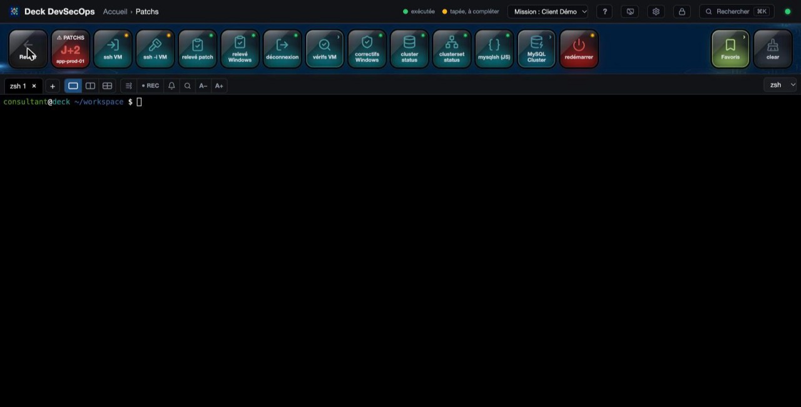
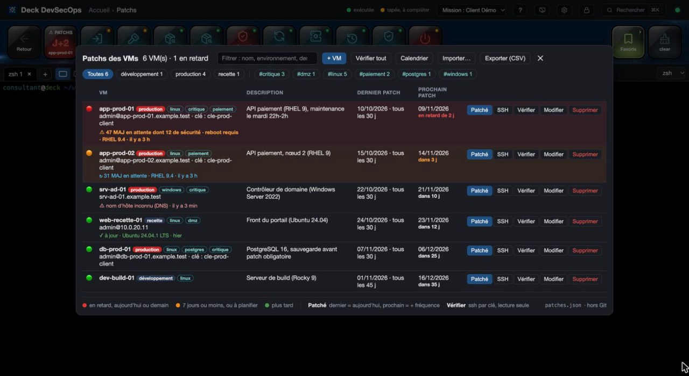
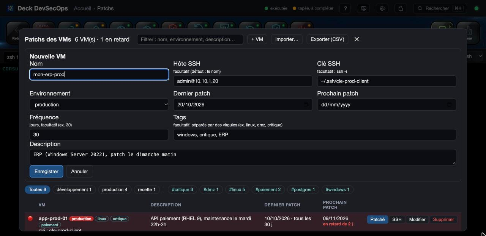
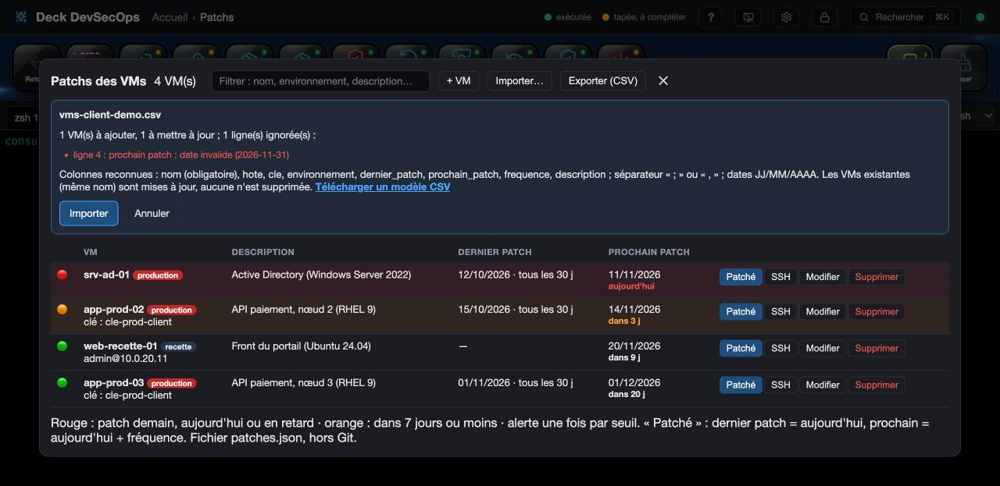

# Patchs des VMs

[← Sommaire](README.md)

Un inventaire de tes VMs avec leurs dates de patch, et un voyant qui t'alerte avant qu'une machine ne prenne du retard.

## La rubrique Patchs

Active-la dans **Réglages › Rubriques** (case **Patchs**). Elle contient :

- le **voyant patchs** (première touche) : le délai de la VM la plus urgente en gros (**J-3** = dans 3 jours, **J** =
  aujourd'hui, **J+2** = 2 jours de retard) et son nom en bas ; un clic ouvre l'inventaire ;
- **ssh VM** : choisis la VM dans la liste de tes hôtes SSH ;
- **ssh -i VM** : choisis d'abord la **clé** (tes clés privées de `~/.ssh`), puis l'hôte → `ssh -i <clé> <hôte>` ;
- des commandes à lancer **sur la VM** (après le ssh) : mises à jour en attente (**MAJ (apt)**, **MAJ (dnf)**),
  **sécurité seule**, **reboot requis ?**, **noyau et boot**, **historique** des derniers paquets, **redémarrer** (dans
  1 min, à valider) ; sous Windows, elles s'activent une fois le terminal connecté en ssh ;
- **correctifs Windows** : les 10 derniers KB installés (PowerShell).

| Couleur du voyant | Signification |
|---|---|
| 🟢 vert | prochain patch dans plus de 7 jours |
| 🟠 orange | dans 7 jours ou moins, ou date à planifier |
| 🔴 rouge | demain, aujourd'hui, ou **en retard** |

**Alertes** : comme pour les certificats, un message dans le deck et une notification du système (si autorisée avec la
cloche des terminaux) quand une VM passe à l'orange puis au rouge, une seule fois par seuil.

## L'inventaire

Les VMs sont triées de la plus urgente à la moins urgente, avec leur environnement (production en rouge), leurs
**tags**, leur description, le dernier et le prochain patch.

**Filtres** (sous l'en-tête) : un bouton par environnement et un par tag, avec le nombre de VMs. Un environnement à la
fois ; les tags se **combinent** (ex. **production** + **#critique** : les VMs de production marquées critiques).
Re-cliquer retire le filtre, **Toutes** les retire tous. Le champ **Filtrer** cherche en plus dans le nom, l'hôte, la
description et les tags. Pour chaque VM :

- **Patché** : le dernier patch devient aujourd'hui et le prochain est recalculé avec la fréquence (ex. tous les 30 j) ;
  l'action est notée dans le [journal](10-reglages-et-tracabilite.md#journal-des-actions) ;
- **SSH** : tape `ssh <hôte>` dans le terminal (sans Entrée), ou `ssh -i <clé> <hôte>` si une clé est renseignée pour
  la VM (affichée sous son nom : « clé : … ») ;
- **Vérifier** : voir ci-dessous ;
- **Modifier**, **Supprimer** (deux clics).

**Calendrier** (en-tête) : les échéances du mois et l'export vers Outlook, voir
[Échéances et synthèse](14-echeances-et-synthese.md).

## Vérifier une VM en un clic

**Vérifier** (sur une VM) ou **Vérifier tout** (en-tête, 4 VMs à la fois) : le deck se connecte en ssh avec la clé de
la VM et lit, **sans rien modifier** :

- le nombre de **mises à jour en attente**, dont celles de **sécurité** (apt, dnf / yum ; zypper et apk : total
  seulement) ;
- si un **redémarrage est requis** (nouveau noyau, `/var/run/reboot-required`, `needs-restarting`) ;
- l'OS, le noyau et depuis combien de jours la VM tourne (au survol).

Le résultat s'affiche sous le nom de la VM et reste dans l'inventaire : « ⚠ 47 MAJ en attente dont 12 de sécurité ·
reboot requis · RHEL 9.4 · il y a 3 h », « ✓ à jour », ou l'erreur en clair. **Patché** l'efface (à re-vérifier
après le patch) ; changer l'hôte ou la clé aussi.

Sécurité :

- **lecture seule** : simulation de mise à jour (`apt-get -s`, `dnf check-update`) et fichiers d'état, sans `sudo` ;
- **jamais de mot de passe** ni de question : connexion par clé uniquement (`BatchMode`). Une VM dont la clé d'hôte
  n'est pas encore connue est refusée : connecte-toi une première fois avec **SSH** pour vérifier et accepter son
  empreinte, le deck ne le fait jamais à ta place ;
- ssh est lancé sans shell local, avec l'hôte de l'inventaire (caractères de shell refusés à la saisie).

Vérification disponible pour les VMs **Linux** ; une VM Windows affiche « vérification disponible pour Linux
seulement » (touche **correctifs Windows** après un ssh).

## Ajouter une VM

**+ VM** : nom (unique), hôte SSH (facultatif : le nom par défaut, ou `admin@10.0.0.5`), **clé SSH** (facultatif :
chemin de la clé privée pour `ssh -i`, tes clés de `~/.ssh` sont proposées ; caractères de shell refusés), environnement,
**tags** (facultatif, séparés par des virgules : `linux, dmz, critique` ; en minuscules, 10 au plus, les tags déjà
utilisés sont proposés), dernier patch,
prochain patch, fréquence en jours, description (rôle, OS, fenêtre de maintenance, contact…). Un clic n'importe où
dans un champ de date ouvre le **calendrier**, aux couleurs du thème (on peut aussi taper la date au clavier). Si tu donnes le dernier
patch et la fréquence, le prochain est calculé. Une erreur s'affiche dans le formulaire sans perdre la saisie.

## Importer des VMs en masse

**Importer…** charge un fichier **CSV** (enregistré depuis Excel, LibreOffice ou un export d'inventaire) :

- une ligne d'en-tête, puis une VM par ligne ; colonnes reconnues, dans n'importe quel ordre, en français ou en
  anglais : `nom` (obligatoire), `hote`, `cle`, `environnement`, `dernier_patch`, `prochain_patch`, `frequence`,
  `tags` (séparés par des virgules), `description` ;
- séparateur `;` (Excel en français), `,` ou tabulation, détecté automatiquement ; valeurs entre guillemets acceptées ;
- dates `JJ/MM/AAAA` ou `AAAA-MM-JJ` ; environnements `prod`, `dev`, `qualif` reconnus.

Un **aperçu** s'affiche d'abord : VMs à ajouter, VMs à mettre à jour (même nom), et lignes ignorées avec leur numéro et
la raison. Rien n'est écrit avant **Importer**. L'import **ajoute ou met à jour, il ne supprime jamais** une VM ; une
sauvegarde est faite juste avant.

- **Télécharger un modèle CSV** (lien de l'aperçu) : un fichier prêt à remplir, avec deux exemples.
- **Exporter (CSV)** : l'inventaire au même format, à modifier dans Excel puis à réimporter.

## Où sont les données ?

Dans `patches.json`, **hors Git**, sauvegardé automatiquement (Réglages › Sauvegardes) et inclus dans l'export de la
[configuration complète](10-reglages-et-tracabilite.md#configuration-complète-et-mise-à-jour), pour passer d'un poste
à l'autre. Le voyant ne calcule qu'à partir des dates : seul **Vérifier** se connecte aux VMs, en lecture seule.
