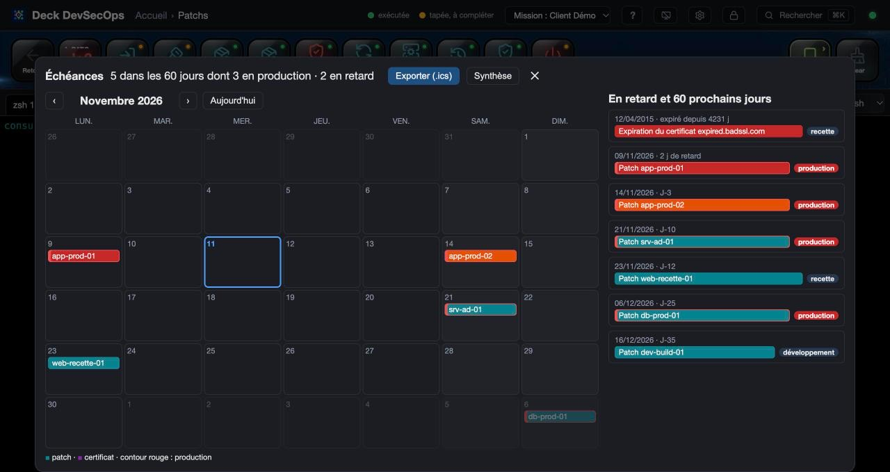
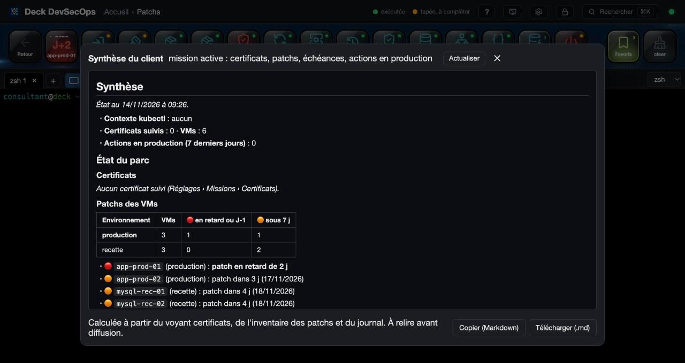
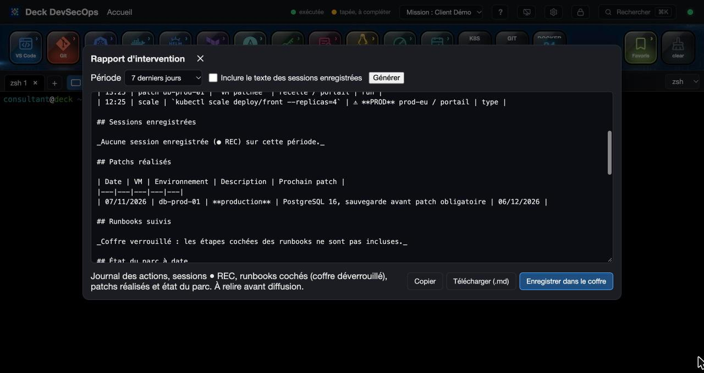

# Échéances et synthèse du client

[← Sommaire](README.md)

Deux vues pour suivre le parc de la mission active, calculées à partir de l'**inventaire des patchs**
([Patchs des VMs](13-patchs.md)), du **voyant certificats** ([Missions et certificats](08-missions-et-certificats.md))
et du **journal** ([Réglages et traçabilité](10-reglages-et-tracabilite.md)). Rien n'est envoyé ailleurs.

## Calendrier des échéances

Ouverture : bouton **Calendrier** de l'inventaire des patchs, bouton **Calendrier** du panneau des certificats, ou
palette **⌘K** › « Échéances ».

- **Le mois** : chaque prochain patch (bleu-vert) et chaque expiration de certificat (violet) à sa date, en **rouge**
  ou **orange** quand c'est urgent (mêmes seuils que les voyants). Un **contour rouge** signale la production.
  ‹ › changent de mois, **Aujourd'hui** revient au mois en cours.
- **À droite** : ce qui est **en retard**, puis les **60 prochains jours** (J-3, J-10…), avec l'environnement.
- **Clic sur un patch** : l'inventaire s'ouvre, filtré sur cette VM.

### Exporter vers Outlook ou Google Agenda

**Exporter (.ics)** télécharge un fichier calendrier à ouvrir avec Outlook (double-clic) ou à importer dans Google
Agenda :

- un événement « journée entière » par échéance, titré `[PROD] Patch app-prod-01` ou `[recette] …` ;
- un **rappel 3 jours avant en production**, 1 jour avant pour les autres environnements ;
- **réimporter met à jour** les événements au lieu de les dupliquer (identifiant stable par VM et par certificat).

Tes échéances apparaissent ainsi dans ton agenda professionnel, même deck fermé. Le fichier ne contient que les noms,
dates et descriptions : ni clé, ni secret.

## Synthèse du client

Ouverture : bouton **Synthèse** du calendrier, ou palette **⌘K** › « Synthèse du client ». Une page prête pour un
point hebdomadaire ou un comité :

- **contexte** : mission, contexte kubectl actuel (signalé s'il est en production), nombre de certificats et de VMs ;
- **état du parc** par environnement : certificats (urgents, à renouveler, injoignables) et VMs (en retard, sous
  7 jours), puis la liste de **ce qui est à traiter** ;
- **échéances** : en retard et dans les 30 prochains jours ;
- **dernières actions en production** (7 jours, d'après le journal).

**Copier (Markdown)** pour la coller dans un mail, Teams ou Confluence, **Télécharger (.md)** pour la garder, et
**Actualiser** après une mise à jour de l'inventaire ou des certificats. À relire avant diffusion.

## Rapport d'intervention enrichi

Le [rapport d'intervention](10-reglages-et-tracabilite.md#rapport-dintervention) contient aussi :

- **Patchs réalisés** sur la période : VMs dont le dernier patch tombe dans la période (bouton **Patché**), avec
  l'environnement et le prochain patch, même si le journal est désactivé ;
- **État du parc à date** : le même tableau que la synthèse, pour clore le compte rendu.
