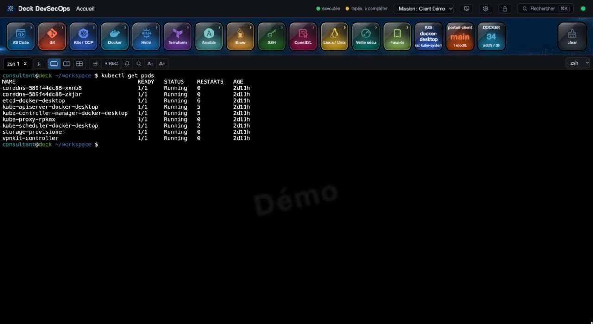
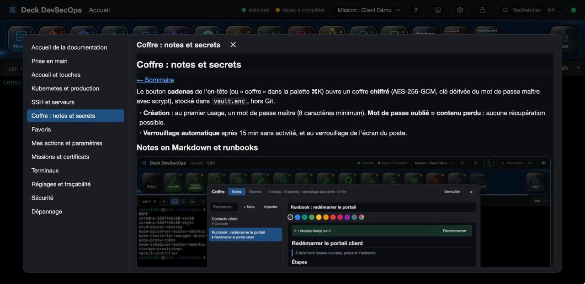

# Documentation de Web Deck DevSecOps

Le poste de pilotage du consultant DevSecOps : des touches qui tapent ou lancent les bonnes commandes, des terminaux,
un coffre chiffré et des garde-fous pour la production. Tout tourne **en local**, sur macOS et Windows : rien ne part
dans un cloud.

Cette documentation est écrite en Markdown dans le dépôt (*Doc as Code*) : elle évolue avec le code, dans les mêmes
commits, et `npm test` vérifie que chaque lien et chaque image existe. Elle s'ouvre aussi **dans le deck**, avec le
bouton **?** de l'en-tête :

> English version: [docs/en/](en/README.md) (le bouton **?** l'ouvre quand l'interface est en anglais).

## Sommaire

1. [Prise en main](01-prise-en-main.md) : installation (macOS, Windows sans droits admin), lancement en service, premier démarrage.
2. [Accueil et touches](02-accueil-et-touches.md) : rubriques, pastilles, voyants, palette ⌘K, raccourcis.
3. [Kubernetes et production](03-kubernetes-et-production.md) : listes réelles, port-forward, contexte et namespace, garde-fous, diff avant d'appliquer.
4. [SSH et serveurs](04-ssh-et-serveurs.md) : hôtes, clés, tunnels, Ansible sous Windows.
5. [Coffre : notes et secrets](05-coffre.md) : notes Markdown, runbooks, secrets, secret dans une commande.
6. [Favoris](06-favoris.md) : liens par client, groupes, export et import.
7. [Mes actions et paramètres](07-mes-actions-et-parametres.md) : tes touches, paramètres nommés, listes réelles, partage.
8. [Missions et certificats](08-missions-et-certificats.md) : profils par client, variables, surveillance des certificats, proxy.
9. [Terminaux](09-terminaux.md) : onglets, disposition, diffusion, enregistrement ● REC et lecteur.
10. [Réglages et traçabilité](10-reglages-et-tracabilite.md) : apparence, journal, rapport d'intervention, sauvegardes, mise à jour, diagnostic, mode partage d'écran.
11. [Sécurité](11-securite.md) : ce que le deck protège, et comment.
12. [Dépannage](12-depannage.md) : problèmes courants et solutions.
13. [Patchs des VMs](13-patchs.md) : inventaire, tableau de bord, dates de patch, voyant et alertes, clusters et VIP, VMs décommissionnées.
14. [Échéances et synthèse](14-echeances-et-synthese.md) : calendrier, export Outlook (.ics), synthèse du client, rapport enrichi.

Pour faire évoluer cette documentation : [Contribuer](CONTRIBUER.md).

> Les captures d'écran viennent d'un deck de démonstration : client, hôtes, secrets et notes sont **fictifs**.
