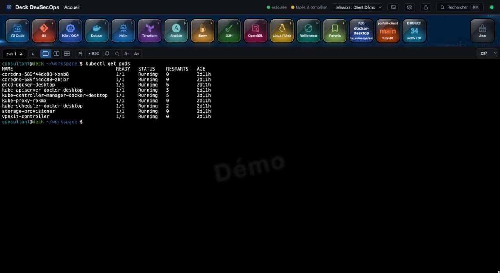
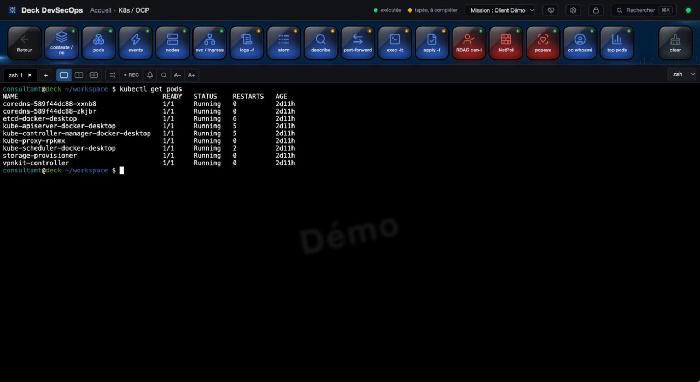
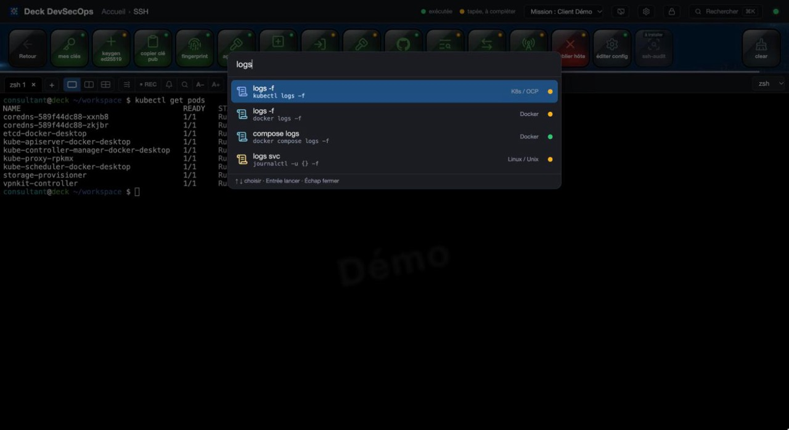

# Home and keys

[← Contents](README.md)

## The home page

- **One key per section**: VS Code, Git, Kubernetes / OpenShift, Docker, Helm, Terraform, Ansible, Brew, SSH,
  OpenSSL, Linux / Unix, Security watch, Favorites, and your own sections ([My actions](07-mes-actions-et-parametres.md)).
- **Live indicators** on the right: kubectl context and namespace (red in production), Git branch and changed files,
  running containers. A click on the kubectl indicator switches context or namespace; on the Git indicator, it picks
  the tracked repository.
- **Favorites** and **clear** are pinned on the right, on the home page as in every section (see [Favorites](06-favoris.md)).
- **clear** clears the active terminal.
- 18 keys at most on the home page; **Settings › Sections** chooses which ones and in which order.

## Sections

Each section gathers a tool's useful commands. The dot at the top right of a key says what it does:

| Dot | Meaning |
|---|---|
| 🟢 green | **Runs immediately** in the active terminal |
| 🟠 orange | **Typed, to complete**: you add an argument, then Enter |

- **Hover**: tooltip with the description and the exact command.
- **Text selected** in the terminal (or in a note): a "to complete" key inserts it at the right place (`{}`),
  otherwise at the end.
- **Automatic return** to the home page after 60 s without action in a section (adjustable).
- **Missing tool**: the key is greyed out "to install"; a click types the install command (brew, scoop…), and the
  key lights up again as soon as the tool is installed.

## ⌘K palette

`⌘K` (or `Ctrl+K`, or **Search**): type a few letters to find and run any key without going through the sections.
The palette also searches, ignoring accents:

- your **favorites** and **missions** (Enter activates the mission);
- with the vault unlocked: your **notes** (title and content) and **secrets** (Enter copies the value, cleared from
  the clipboard after 30 s);
- the **recent commands** launched from the deck, with their values: Enter **types them without running them**.

## Shortcuts

- `⌥1` to `⌥9` (`Alt+1`… on Windows): the keys of the displayed page, in order.
- `⌘K` palette, `⌘F` search in the terminal, `⌘+` / `⌘−` text size.
- **Pinning** an action from [My actions](07-mes-actions-et-parametres.md) also puts it on the home page.
