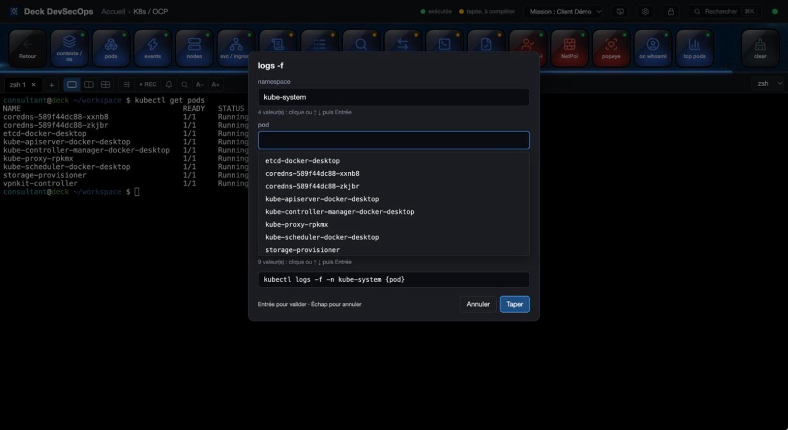
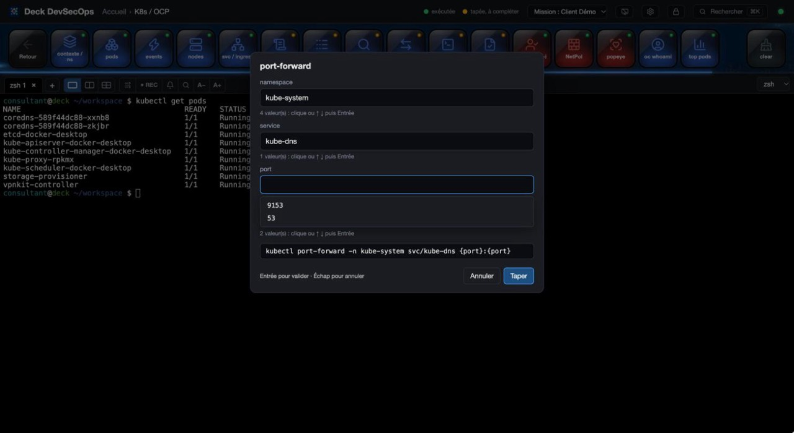
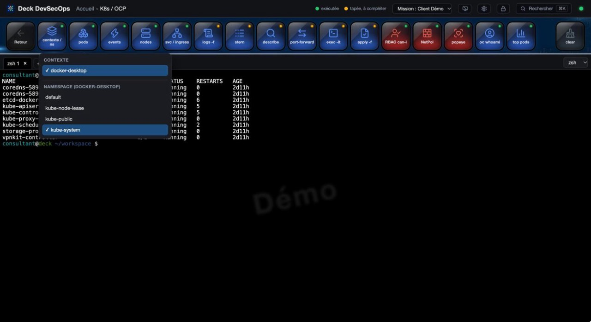
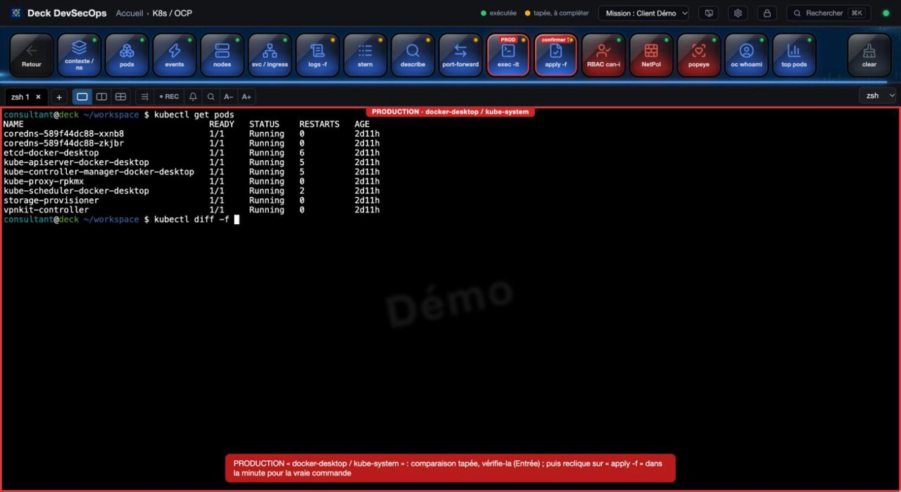

# Kubernetes and production

[← Contents](README.md)

## Live lists instead of copy-paste

With no text selected, the **logs -f**, **describe**, **exec -it** and **stern** keys open a window that offers the
**live list**: namespaces, then the pods of the chosen namespace (read with `kubectl`). The list opens when you click
a field, filters as you type, and is driven with the mouse or with ↑ ↓ and Enter. An empty namespace is reported. With
a name selected in the terminal, the key uses it directly, as before.

Same principle for Docker (**logs -f**, **exec -it**, **inspect**: containers; **dive**: images).

## port-forward

**port-forward** asks for the namespace, the service, then offers **the service's real ports**:
`kubectl port-forward -n kube-system svc/kube-dns 9153:9153`. The command is typed; running it is up to you.

## Context and namespace

**context / ns** (or a click on the kubectl indicator of the home page) lists the contexts of your kubeconfig and the
namespaces of the current context. Choosing a **production** context or namespace takes a **second click**: the line
first shows "⚠ PRODUCTION: …, click again to confirm".

## Production safeguard

The context is "production" when its name or namespace matches the **production pattern** (`prod|prd` by default,
adjustable per [mission](08-missions-et-certificats.md)). Then:

- the terminals get a **red border** and the **PRODUCTION · context / namespace** banner;
- the kubectl indicator turns red (**⚠ PROD**);
- sensitive keys (**exec -it**, **apply -f**, **helm upgrade -i**, **rollback**, **uninstall**) show **PROD** and
  need a **second click** within 5 s.

## See before applying

In production, **apply -f** (K8s) and **upgrade -i** (Helm) first type the **comparison**: `kubectl diff -f …` or
`helm diff upgrade --install …` ([helm-diff](https://github.com/databus23/helm-diff) plugin), with your selected
text. You run it (Enter) and read what is going to change; **nothing is applied**. A second click **within a minute**
types the real command, with the same selection.
