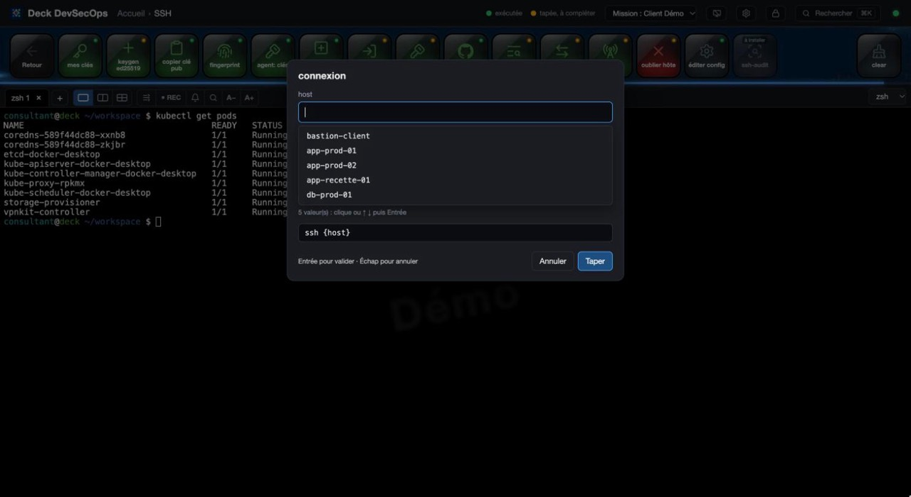
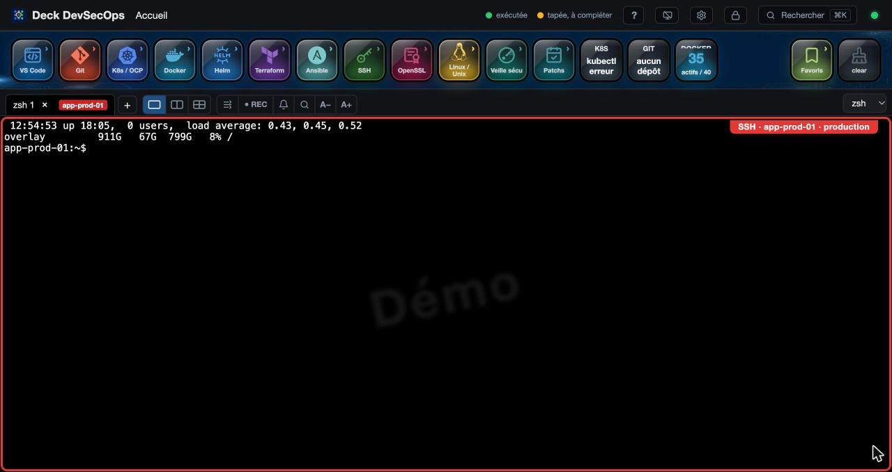
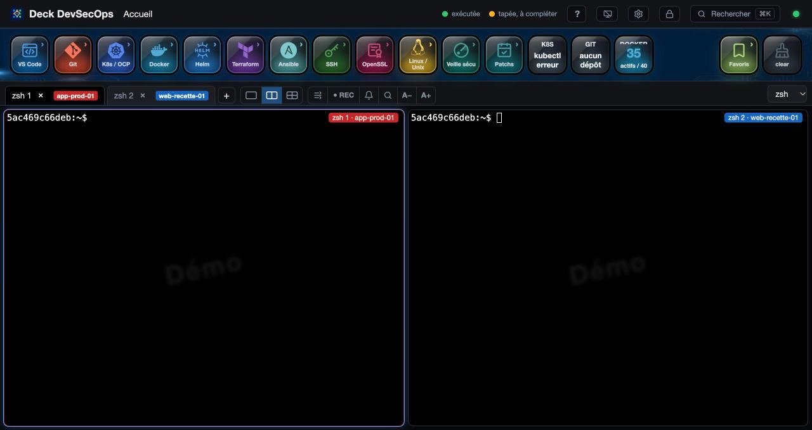

# SSH and servers

[← Contents](README.md)

## Connecting

- **connect**: list of the hosts in your `~/.ssh/config` (`Host` lines, `Include` followed, patterns such as
  `Host *` ignored). The file is only read. You can also type an address (`user@10.0.0.5`).
- **connect -i**: first choose the **key**, then the host → `ssh -i <key> <host>`. The private keys of `~/.ssh`
  (`%USERPROFILE%\.ssh` on Windows) are recognised by their `.pub`, a usual name (`id_ed25519`, `id_rsa`…), the
  `.pem` / `.key` extension, or their `-----BEGIN … PRIVATE KEY-----` header (only that first line is read, never the
  key). PuTTY keys (`.ppk`) are not offered: `ssh -i` cannot read them (convert them with PuTTYgen, *Export OpenSSH
  key*).
- **tunnel -L**: host, local port, target and remote port (8080, localhost and 80 pre-filled).

If you always use the same key for a host, write it once in `~/.ssh/config` (`IdentityFile`): **connect** is then
enough.

## Knowing which machine you are typing on

As soon as a terminal is connected over **ssh** (or **wsl**), the deck shows the machine:

- **a colored frame** around the terminal: **red** if the VM is in **production**, blue otherwise;
- **a label hooked at the top of the frame**: "SSH · app-prod-01 · production" (in split view, 2 or 4 terminals:
  "zsh 2 · web-recette-01" in the corner of each screen);
- **on the tab**: the name of the **inventory VM** ([Patches](13-patchs.md)) if the host is listed there, otherwise
  the host name, in the same color; on hover, the full destination.

The VM is recognised by its host (`admin@app-prod-01.client.fr`), its host name without user, its short name or its
inventory name (`~/.ssh/config` alias with the same name). Only the destination is read from the ssh command: neither
the key, nor the options, nor the remote command. On disconnection (`exit`), the tab becomes local again.

**Bastion (CyberArk PSMP…)**: with a `account@target_user@target_vm@bastion` destination, the **target VM** is shown
and matched with the inventory, with the "via bastion" mention (the bastion when hovering the tab).

**Git Bash (Windows)**: the intermediate process between bash and ssh disappears, so ssh no longer has a parent
visible to Windows; the deck finds its lineage in Git Bash's process table (`ps.exe` shipped with Git) and attaches
it to the right terminal ("Git Bash lineage" in the diagnostics). Allow 2 to 5 seconds after connecting.

If the frame does not appear, **Settings › Server › Diagnostics**, line **Connected terminals**, with a terminal
connected: it says whether monitoring runs, and for each ssh seen, its process lineage and why it is (or is not)
attached to the terminal.

## The other keys

Keys (`ssh-keygen`, copy the public key, fingerprint), agent (`ssh-add`), `ssh -T git@github.com`, `ssh-keyscan`,
forget a host (`ssh-keygen -R`), edit `~/.ssh/config`, audit (`ssh-audit`).

## Ansible on Windows

Ansible does not run on Windows. The **Ansible** section is greyed out there, then **enables itself** when the active
terminal is connected over **ssh** to a Linux / macOS machine (or opened in **wsl**).
