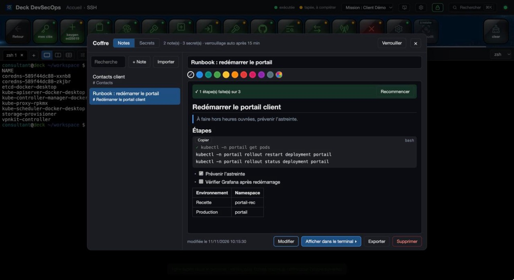
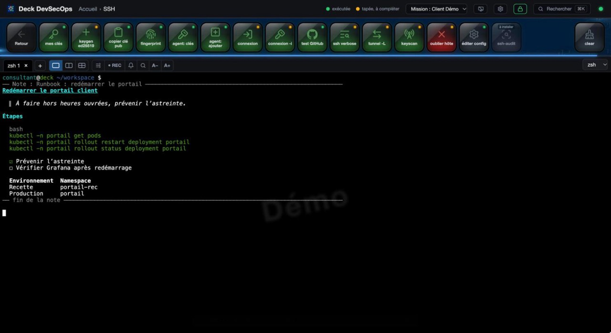
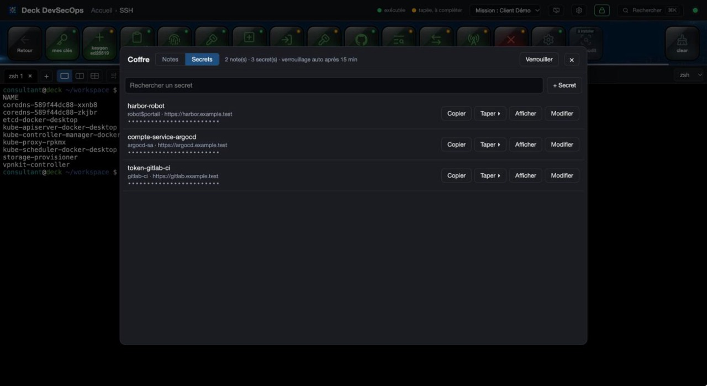
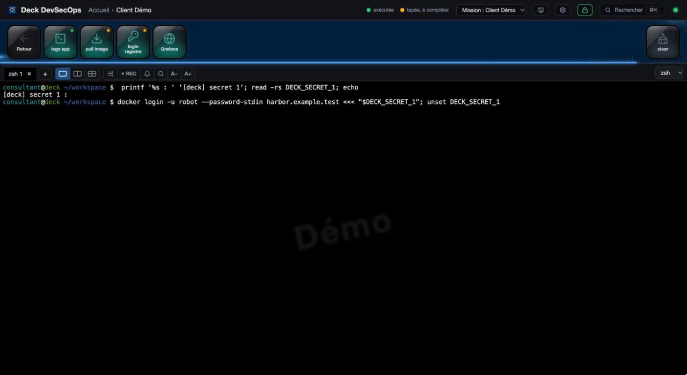

# Vault: notes and secrets

[← Contents](README.md)

The **padlock** button in the header (or "vault" in the ⌘K palette) opens an **encrypted** vault (AES-256-GCM, key
derived from the master password with scrypt), stored in `vault.enc`, outside Git.

- **Creation**: on first use, a master password (8 characters minimum). **Forgotten password = content lost**: no
  recovery is possible.
- **Automatic lock** after 15 min without activity, and when the computer's screen locks.

## Markdown notes and runbooks



- Headings, lists and checkboxes, **bold**, `code`, code blocks, quotes, tables, links; one color per note.
- **Preview**: each **code line is clickable**; it is typed in the terminal (without Enter) and marked ✓. The
  **runbook** progress is kept in the vault ("1 of 3 steps done"); **Start over** resets it.
- **Copy** copies a whole code block.
- **Selection**: text selected in a note is used by the next "to complete" key.



**Show in the terminal ▸** prints the formatted note in the active terminal (nothing is sent to the shell): you select
a pod name or a command there, then click a key.

**Export** on a note creates a `.md` file **in clear text** (a second click is required if it seems to contain a
secret); **Import** adds `.md` files as encrypted notes.

## Secrets



- **Unique name without spaces** (`harbor-robot`, `token-gitlab-ci`): in the form, a space becomes a dash.
- **Copy**: copied to the clipboard **by the server**, cleared after 30 s (the value does not go through the page).
- **Type ▸**: typed in the terminal at a password prompt, without Enter.
- **Show**: visible for a few seconds.

## A secret in a command, without showing it



In a [My actions](07-mes-actions-et-parametres.md) command, `{secret:name}` refers to a vault secret:

```text
docker login -u robot --password-stdin {mission.registry} <<< {secret:harbor-robot}
```

On click, the shell reads the secret **without echo** (`read -rs` in bash / zsh, `Read-Host -AsSecureString` in
PowerShell, also over ssh): the **server** sends it the value once the prompt is shown. The command uses the
`"$DECK_SECRET_1"` variable, cleared right after. The value appears **neither on screen, nor in the shell history,
nor in the log, nor in ● REC recordings**. Refused in `cmd` and in broadcast mode.

## Backing up or moving the vault

**Settings › Vault**: **Export** (encrypted file, unreadable without the master password) and **Import** (merge with
the current vault, or replace it). When merging, a secret whose name is already taken is renamed `name-importe`.
