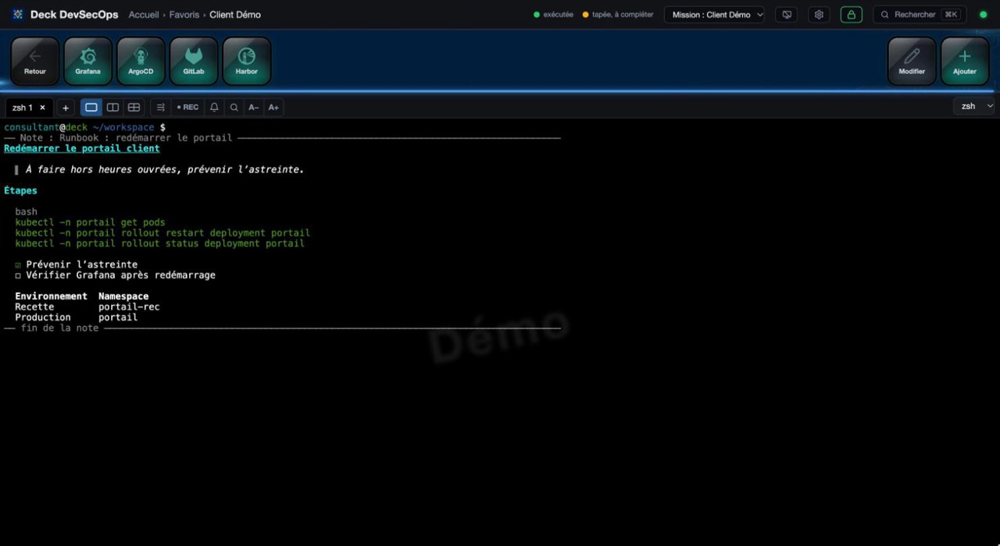

# Favorites

[← Contents](README.md)

Your useful links (Grafana, ArgoCD, GitLab, registries, documentation…), opened in a new tab.

## Always at hand

The **Favorites** key is **pinned to the left of clear**, on the home page and in every section:

1. From a section (Kubernetes, for example), a click on **Favorites** shows your sites (or directly the active
   mission's group).
2. **After your choice**, the site opens and the deck **returns to the section you came from**.
3. **Without a choice within 30 s**, automatic return to that section; the bar under the keys shows the time left
   ("back to "K8s / OCP" in … s" on hover). Entering a group restarts the 30 s.
4. **Back** from the top of the favorites also returns to the starting section; **Edit** mode pauses the countdown.

- **Add**: name and address (`https://` added when needed), automatic icon for well-known sites.
- **Groups and sub-groups** (per customer, per environment), with a color; 12 items per level.
- **Edit**: drag and drop to reorder or put into a group, rename, delete.
- **Active mission**: the **Favorites** key opens the mission's group directly (see
  [Missions](08-missions-et-certificats.md)).
- Every favorite can be found with the **⌘K** palette.

## Export and import

**Settings › Favorites**: **Export** creates a JSON file; **Import** merges or replaces. Handy to move from one
computer to another, or to share a mission's links with a colleague. Favorites (`favoris.json`) stay outside Git: a
customer's addresses never end up in the repository.
