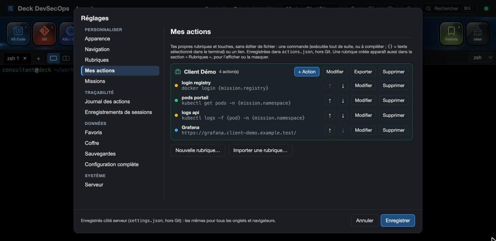
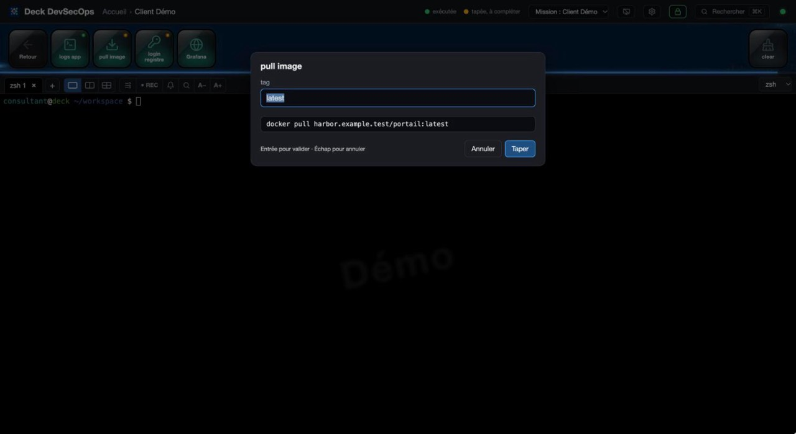

# My actions and parameters

[← Contents](README.md)

## Creating your own keys without touching the code

**Settings › My actions**: **New section…** (name, icon, color), then **+ Action**:

- a **command**, run immediately or to complete (`{}` = text selected in the terminal);
- or a **link** (http or https).

Each action has a name, an icon (automatic when empty) and a tooltip; it can be **pinned to the home page**.
Everything is stored in `actions.json`, outside Git, and backed up automatically. An error shows in the form without
losing what you typed.

## Named parameters

A command can contain parameters: `kubectl logs -n {namespace} {pod} --since={durée=15m}`. On click, a window asks
for each value, with a preview of the command:

- `{name=value}`: pre-filled **default value**;
- the **latest values** are offered (never for a sensitive parameter: `password`, `token`, `secret`…);
- **live lists** for `namespace`, `pod`, `deployment`, `service`, `node`, `context`, `container`, `image`, `host`
  (SSH hosts), `identity` (SSH keys) and `port` (ports of the chosen service);
- `{mission.name}`: **variable of the active mission** (e.g. `{mission.registry}` → `harbor.example.test`);
- `{secret:name}`: **vault secret**, read by the shell without being shown (see
  [Vault](05-coffre.md#a-secret-in-a-command-without-showing-it)).

## Sharing a section

**Export** (on the section) creates `rubrique-<name>.json`. A colleague adds it with **Import a section…**, after
seeing the list of commands (in green, those that run as soon as they are clicked). Everything is validated again,
nothing is pinned, a name already taken becomes "(importée)". `{mission.…}` placeholders stay as they are: everyone
uses the values of their own mission.

## Going further

The catalog's sections and shortcuts can also be configured in `config.jsonc` (`customSections`, `customShortcuts`);
see the `README.md` at the root of the repository.
