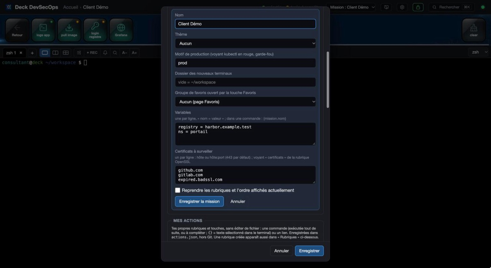
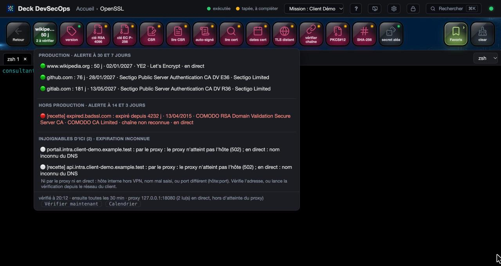

# Missions and certificates

[← Contents](README.md)

## One profile per customer



**Settings › Missions › New mission…** saves a profile:

- a **theme** in the customer's colors, the **displayed sections and their order**;
- a **production pattern** (red kubectl indicator, safeguards; empty = `prodPattern` from `config.jsonc`);
- the **new terminals folder** and the **favorites group** opened by the Favorites key;
- **variables** (`registry = harbor.client.fr`), usable in commands: `{mission.registry}`;
- **certificates to watch**.

The **Mission** selector in the header activates it in one click. While a mission is active, what you change in
**Sections** and the theme is saved in the mission: activating it again does not bring back the old sections.
Missions are stored in `settings.json`, outside Git.

## Certificate monitoring



In the mission, one line per certificate: the address (`api.client.fr`, `ldap.client.fr:636`; a full URL is
accepted), then its **environment**:

```text
api.client.fr production
portail.client.fr prod
recette-api.client.fr recette
dev-api.client.fr dev
```

Environments are typed in French: `production`, `recette` (UAT), `qualification` (QA), `développement`, `autre`
(abbreviations `prod`, `rec`, `qualif`, `dev` accepted). **Without an environment, the certificate is treated as
production**: nothing escapes the strictest monitoring.

The thresholds depend on the environment:

| Environment | 🟠 orange | 🔴 red | Alerts |
|---|---|---|---|
| Production | less than 30 days | less than 7 days, or expired | orange then red |
| Non-production | less than 14 days | less than 3 days, or expired | red only |

The **certificates** indicator, first key of the **OpenSSL** section (or `cert-status` on the home page through
`config.jsonc`), shows **the most urgent production certificate** (short name, days left). A non-production problem
does not change its color: it is reported at the bottom of the key ("1⚠ non-prod"). **Unreachable** certificates
(unknown expiry) are counted separately: "6 to check". Grey: no certificate tracked, or none readable.

- **Click**: the list of all certificates in three parts, **Production**, **Non-production** (with each one's
  environment), then **Unreachable from here** (with the reason in plain words). For each: days left, date, issuer,
  unrecognised chain, "direct" if it was read without the proxy. At the bottom: time of the check, proxy used,
  **Check now** and **Calendar**. Otherwise, a check every 30 min.
- **↗** at the end of each line (or a click on the line): opens the site in the browser (`https://host`, or
  `https://host:port`). No link for ports that are not websites (LDAPS 636, IMAPS 993, SMTPS 465…).
- **Alert**: message in the deck and system notification (if allowed with the terminals' bell), only once per
  threshold; in non-production, only when red.
- The date is read with a simple TLS handshake (Node, without openssl, 10 s max). Nothing else is sent.

## Corporate computer and proxy

On a network where all traffic goes through a proxy (e.g. Zscaler) and where internal DNS does not resolve public
names. Proxy at the office, none at home: **Automatic** mode in
[Settings › Proxy](10-reglages-et-tracabilite.md#proxy-office-or-home).

- set `HTTPS_PROXY` for your user (`setx HTTPS_PROXY http://proxy:8080` on Windows), then restart the deck;
- the check then goes through a `CONNECT` tunnel of the proxy; `NO_PROXY` is respected;
- **direct fallback**: if the proxy does not reach a host (502, 503, 504, refusal, timeout), the case of the
  company's **internal** names (`*.intra…`) reachable only from the internal network or the VPN, the deck retries
  **without the proxy**; a certificate read this way is marked "direct", and that path is tried first the next time.
  If both fail, both reasons are shown (e.g. "through the proxy: 502; directly: name unknown to DNS"): host outside
  the VPN, mistyped name, or different port (`host:port`);
- if the proxy **decrypts TLS**, the certificate seen is the proxy's: the line is marked ⚠ and does not count for the
  color;
- distinct errors: name unknown to DNS, proxy unreachable, proxy refusal (403, 407, 502…), timeout.

The [diagnostics](10-reglages-et-tracabilite.md#diagnostics) check all of this in one click.
