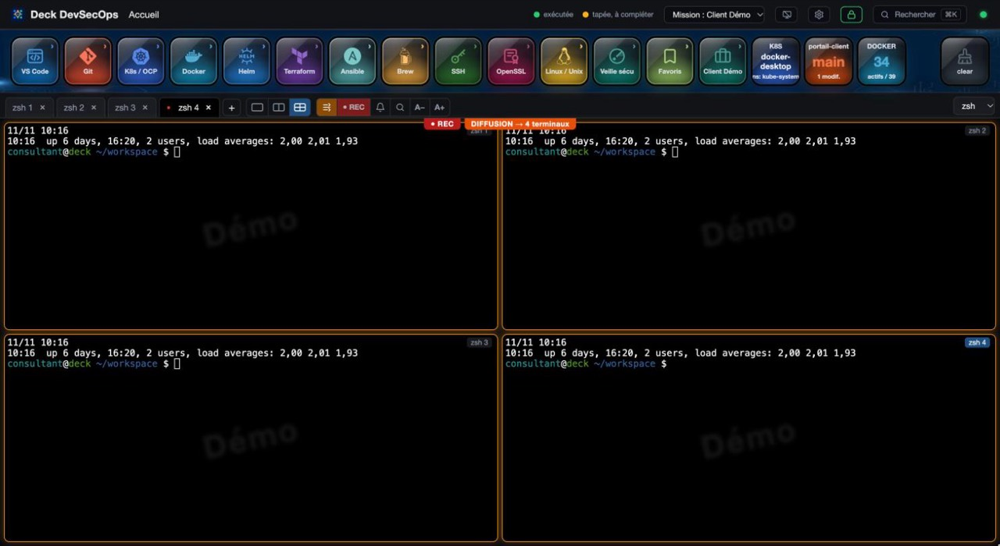
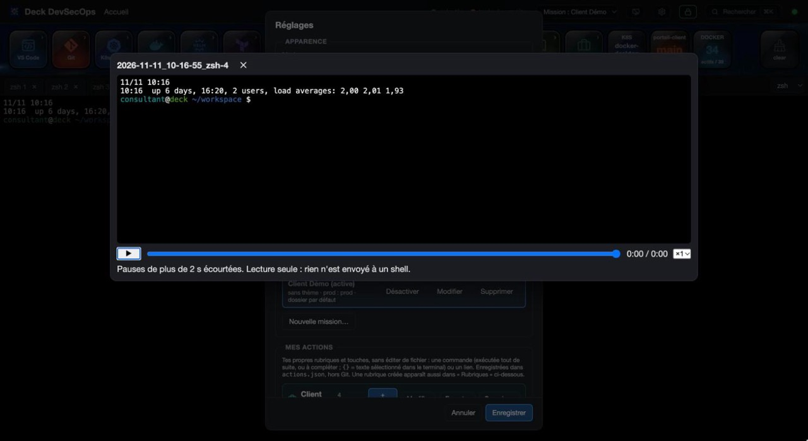

# Terminals

[← Contents](README.md)

The terminals are real shells of your computer (zsh, bash, PowerShell, Git Bash, cmd), displayed with xterm.js.

## Tabs and layout

- **+** opens a terminal (shell chosen on the right); double-click a tab to **rename** it; drag to reorder. Terminals
  are reopened after the deck restarts.
- Layout: **1**, **2×1** (side by side) or **2×2**; the active one receives the keys.
- **Search** (`⌘F`), **text size** (`A−` / `A+`), **notification** when a long command finishes (bell).
- Clickable links, usual copy and paste, watermark signature (adjustable).

## Broadcast

The **broadcast** button (lines and arrows) sends your typing, and the deck's keys, to **all visible terminals**:
handy to run the same check on several servers. The terminals get an orange border and the **BROADCAST → n
terminals** banner reminds you of it.

## Recording a session (● REC)

**● REC** records everything shown in the active terminal (proof of intervention, report); red dot on the tab and
**● REC** banner; click again to stop (automatic stop when the terminal closes or at 50 MB).

- Two timestamped files in `.deck-recordings/` (outside Git): `.cast` (replayable with `asciinema play`) and `.txt`
  (text without colors, ready for a report).
- Only what is **shown** is recorded: a password typed at a prompt (not displayed) is not in it, nor vault notes
  displayed by the deck.

## Replaying a session

**Settings › Session recordings**: **▶** replays the session in the deck, read only. Play / pause (Space), progress
bar, speed ×1 to ×8, pauses longer than 2 s shortened. **Open the folder** gives access to the files.
