# Settings and traceability

[← Contents](README.md)

The **gear** in the header opens the Settings.

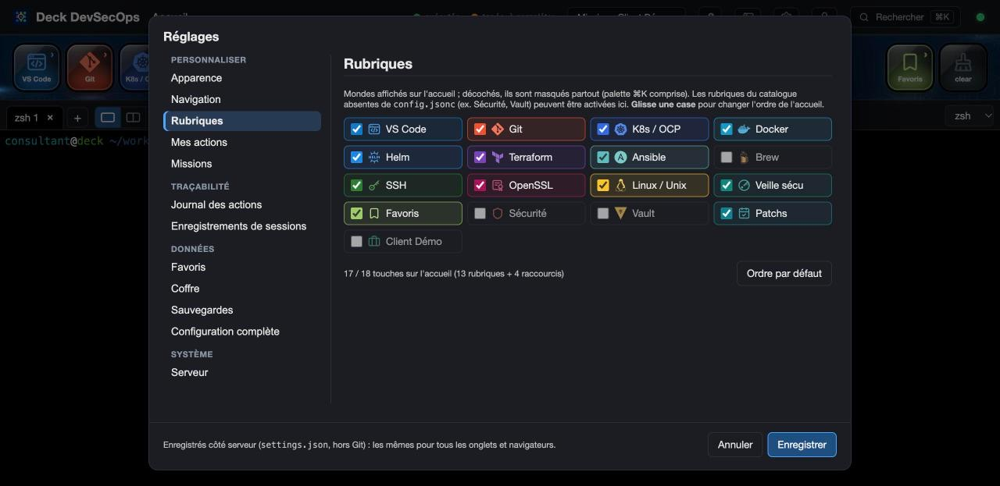

One section at a time: the **left menu** groups them into four parts, and the content scrolls on the right.

| Part | Sections |
|---|---|
| Customize | Appearance, Navigation, Sections, My actions, Missions |
| Traceability | Action log (and intervention report), Session recordings |
| Data | Favorites, Vault, Backups, Full configuration |
| System | Proxy (office / home), Server (update, diagnostics, app) |

The panel reopens on the last section viewed. **Cancel** and **Save** stay visible at the bottom, whatever the
section; **Save** saves every section at once. An invalid field in another section (e.g. the return-home delay) shows
it automatically. On a narrow screen, the menu moves to the top.

## Appearance

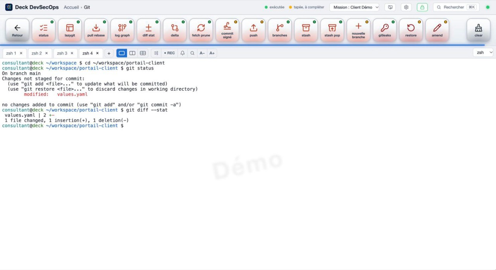

- **Dark**, **light** or **system** mode.
- **Mission theme** in a customer's colors (header, key bar).
- **Terminal signature**: text or image as a watermark, behind each terminal.

### Language: French or English

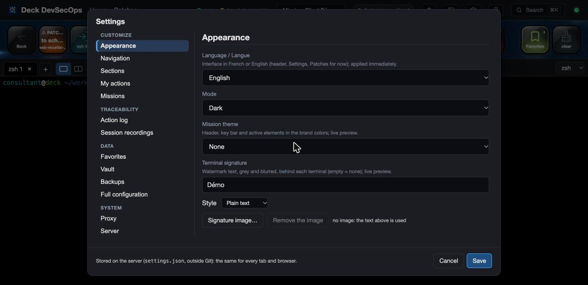

**Language / Langue** switches the interface to **English** (or back to French), immediately, without reloading the
page; **Cancel** goes back to the previous language, **Save** keeps it (`settings.json`, the same in every browser).

The whole interface is translated: header, home page and indicators, every section (key names, tooltips),
**Settings**, **Patches** (inventory, clusters, dashboard), vault, favorites, ⌘K palette, terminals (bar, search,
broadcast, recording), due dates, report and messages; dates follow the language (day/month in both cases). The
**documentation** (the **?** button) opens in the interface language.

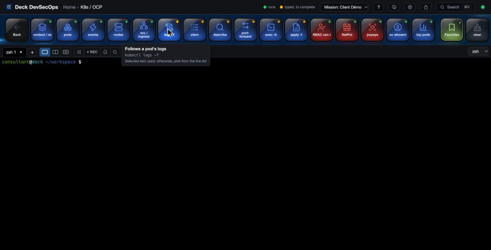

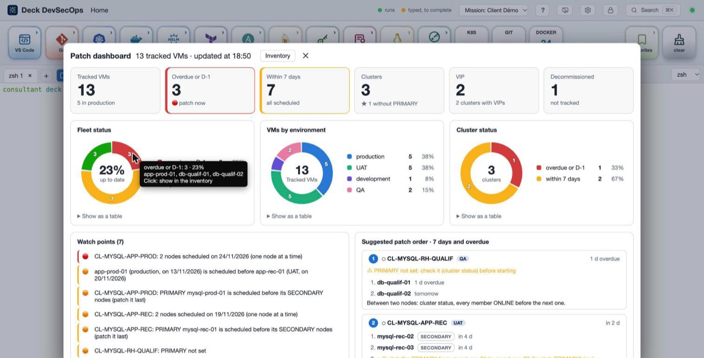

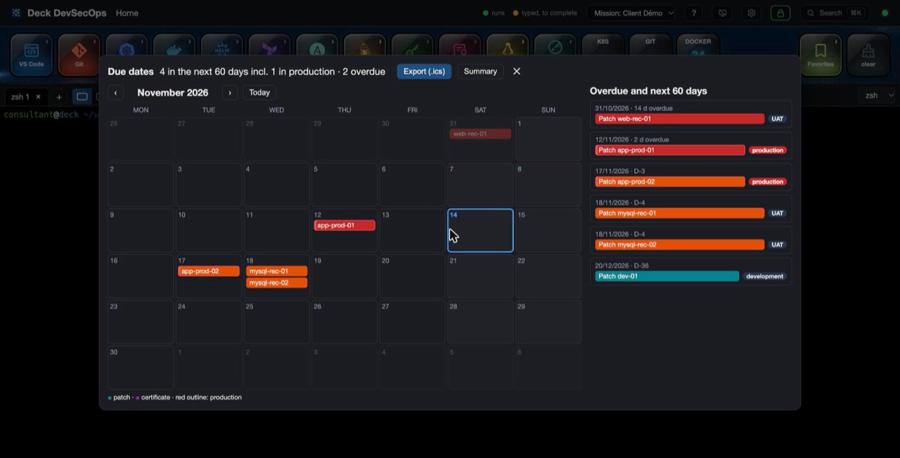

The **documents produced for the customer** stay in French (intervention report, customer summary, `.ics` due-date
file), to review before sharing. The documentation's screenshots show the French interface.

What you type is never translated: VM names, descriptions, tags, mission names, commands, terminal output. The values
to type are the same in both languages (environments `production`, `recette`… in the fields and the CSV).

The translations live in `public/i18n/en.js`: key = displayed French text, value = English text; `{0}`, `{1}` stand
for numbers and names (`"{0} VM(s)": "{0} {0:VM|VMs}"` picks singular or plural). A text missing from the dictionary
stays in French: to translate a new one, add its line.

## Sections and navigation

- **Sections**: check those of the home page, drag for the order (18 keys at most).
- **Automatic return to the home page** after an action, with an adjustable delay.

## Action log

Every action launched from the deck is logged: date, key, command (run or typed), terminal, kubectl context (red if
production). Commands typed by hand and vault values are not logged. **Export (CSV)** for Excel. File
`.deck-journal.jsonl`, outside Git.

## Intervention report

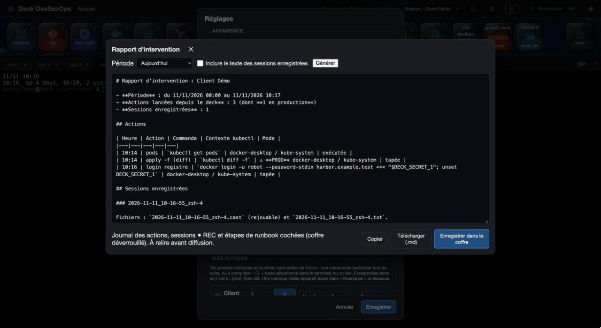

**Intervention report…** assembles a Markdown report for a period (today, 4 h, since yesterday, 7 days, or since a
date):

- the actions of the log, with **⚠ PROD** when it was production;
- the **● REC** sessions (text included on request);
- the runbook steps checked (vault unlocked);
- the **patches done** during the period and the **fleet status as of today** (certificates and VMs per environment),
  see [Due dates and summary](14-echeances-et-synthese.md#enriched-intervention-report).

You review and edit it, then **Copy**, **Download (.md)** or **Save to the vault**. Nothing is sent anywhere else.
The report is written in French.

## Backups

Before each change to favorites, My actions, settings or the vault, a copy is kept in `.deck-backups/` (10 per
file). **Restore** first backs up the current version.

## Full configuration and update

- **Full configuration**: export / import in one file of your favorites, My actions, settings, missions,
  [VM patches](13-patchs.md) and signature (the vault is exported separately, encrypted). Ideal to move from your Mac
  to your PC.
- **Update** (Settings › Server): compares with GitHub, runs `git pull`, installs dependencies when needed and
  restarts. Refused if tracked files were changed on the machine, so as not to overwrite anything.

## Proxy: office or home

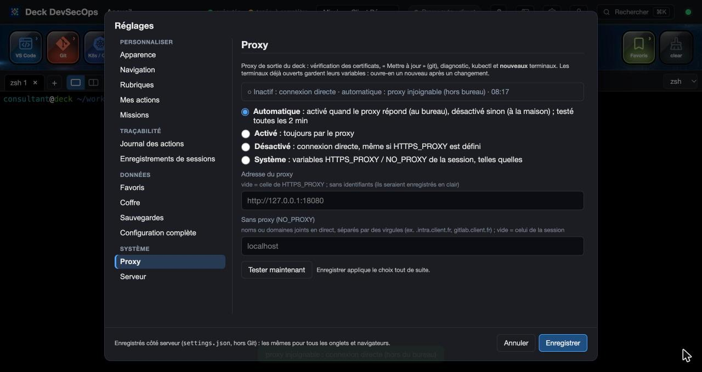

For a computer that goes through the company proxy at the office, but not at home: **Settings › Proxy**.

| Mode | Behavior |
|---|---|
| **Automatic** (recommended) | Proxy used **if it answers** (at the office), direct connection otherwise (at home). Tested at startup, every 2 minutes and with **Test now**; a message shows when it changes. |
| **On** | Always through the proxy. |
| **Off** | Direct connection, even if `HTTPS_PROXY` is set in the session. |
| **System** | The session's `HTTPS_PROXY` / `NO_PROXY` variables, as they are (default behavior). |

- **Proxy address** and **no proxy (NO_PROXY)**: empty = those of the session variables (shown in grey). No
  credentials in the address: they would be stored in clear text; keep them in the `HTTPS_PROXY` variable.
- The choice applies to everything leaving the deck: certificate checks, **Update** (git, overriding an `http.proxy`
  from the git configuration), diagnostics, kubectl and **new terminals**. Terminals already open keep their
  variables: open a new one after a change.
- **Header**: the **Proxy** button shows the state (green dot = proxy on; "Auto proxy · office" or "· direct"); a
  click changes mode immediately.

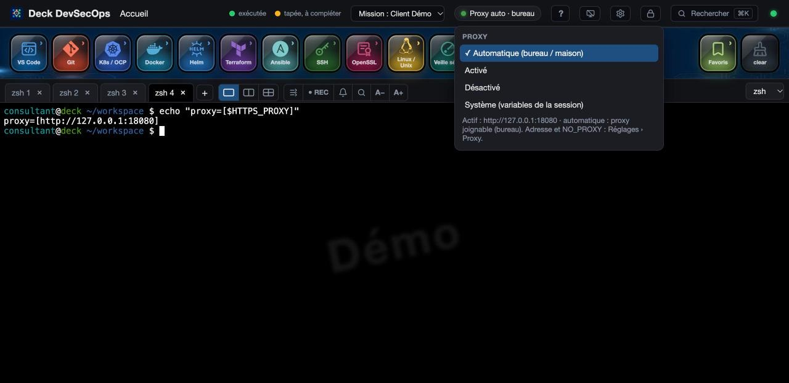

## Diagnostics

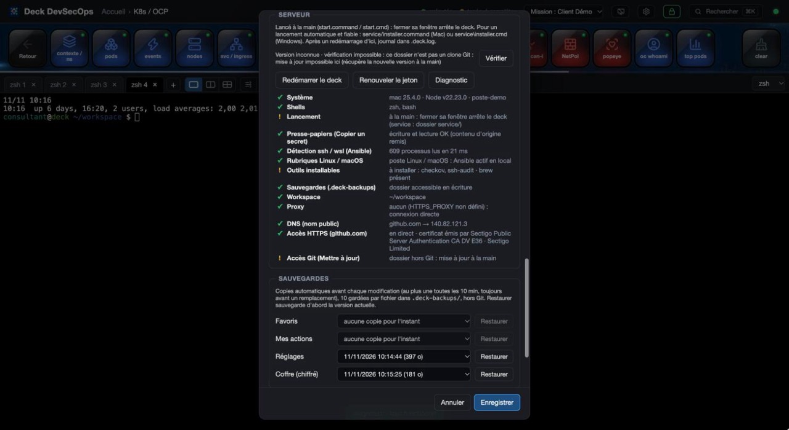

**Settings › Server › Diagnostics** checks what depends on the computer: clipboard, ssh / wsl detection,
**connected terminals** (monitoring active, last reading, each ssh seen with its process lineage and why it was or
was not detected: machine frame, VM keys), tools to install, backups, shells, running as a service, and **network**:
proxy (`HTTPS_PROXY`, credentials masked), DNS of a public name, HTTPS access (direct or through the proxy, TLS
interception reported), Git access for **Update**.

## Screen sharing mode

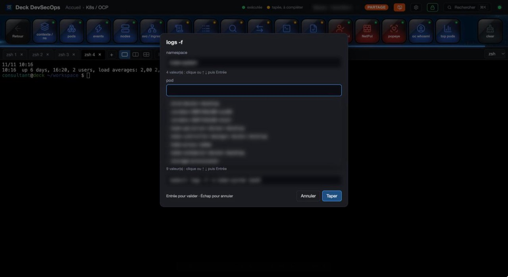

Before a meeting or a demo, the **crossed-out screen** button in the header (**SHARING** badge) blurs what reveals a
customer's infrastructure: kubectl context and indicators, mission, notes, secrets, host and pod lists, selectors,
palette, sensitive settings, report, player. **Hovering an area shows it**; the terminal stays visible.
