# VM patches

[← Contents](README.md)

An inventory of your VMs with their patch dates, and an indicator that warns you before a machine falls behind.

## The Patches section

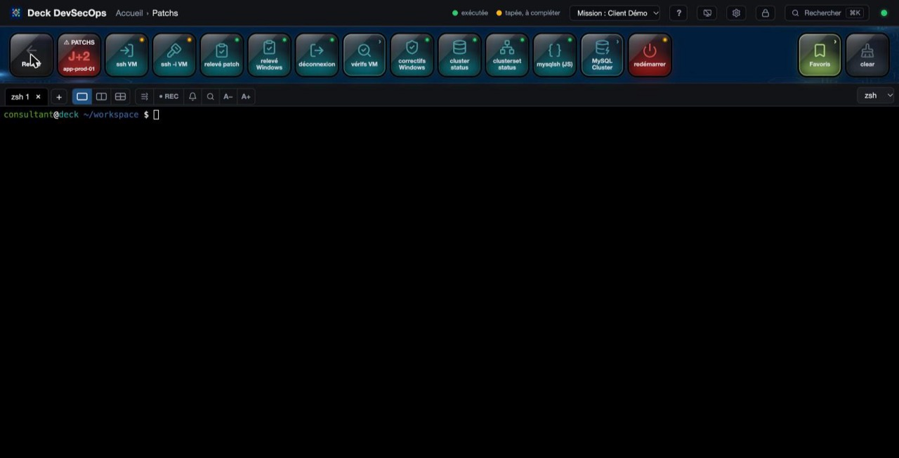

Enable it in **Settings › Sections** (**Patches** box). It contains:

- the **patch indicator** (first key): the delay of the most urgent VM in large type (**D-3** = in 3 days, **D** =
  today, **D+2** = 2 days overdue) and its name at the bottom; a click opens the inventory;
- **ssh VM**: pick the VM in the list;
- **ssh -i VM**: pick the VM; its **key** is taken from the inventory (otherwise pick one of your private keys in
  `~/.ssh`) → `ssh -i <key> <host>`;
- **patch survey** / **Windows survey**: the connected VM's real state (last patch, updates, security, reboot), which
  updates the inventory, see [Patch survey](#patch-survey-the-vms-real-state);
- **VM checks**: the sub-page of detailed checks to run **on the VM** (after the ssh; the survey sums them up): pending
  updates (**updates (apt)**, **updates (dnf)**), **security only**, **reboot needed?**, **kernel & boot**, **history**
  of the latest packages; on Windows, they are enabled once the terminal is connected over ssh;
- **reboot**: reboots the VM in 1 min (typed, to confirm);
- **Windows hotfixes**: the last 10 KBs installed (PowerShell);
- **MySQL InnoDB Cluster**, from a terminal connected to a node of the cluster (read only; mysqlsh asks for the root
  password in the terminal; the deck does not see it):
  - **cluster status**: `` mysqlsh root@`hostname` -- cluster status `` (node states, PRIMARY / SECONDARY, quorum);
  - **clusterset status**: `` mysqlsh root@`hostname` -- clusterset status --extended=1 ``, to use when
    `cluster status` fails because the ClusterSet is not ONLINE;
  - **mysqlsh (JS)**: `` mysqlsh root@`hostname` --js ``, the interactive shell in **JavaScript mode**, the one needed
    for `dba.getCluster()`, `forceQuorumUsingPartitionOf()`, `rejoinInstance()`, `rebootClusterFromCompleteOutage()`
    (in SQL mode, syntax error);
  - **MySQL Cluster**: the sub-page of commands to run **inside** that JS session, see below.

| Indicator color | Meaning |
|---|---|
| 🟢 green | next patch in more than 7 days |
| 🟠 orange | in 7 days or less, date to schedule, or pending security updates (survey) |
| 🔴 red | tomorrow, today, or **overdue** |

**Alerts**: as for certificates, a message in the deck and a system notification (if allowed with the terminals'
bell) when a VM turns orange then red, only once per threshold.

In these lists (and in every key that asks for a host, SSH section included), **the inventory VMs come first**, in
alphabetical order, with their name and environment on the right; then the hosts of `~/.ssh/config`. Type a few
letters (VM name, host or environment) to filter.

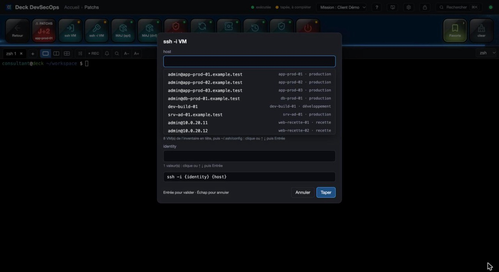

## Patch survey: the VM's real state

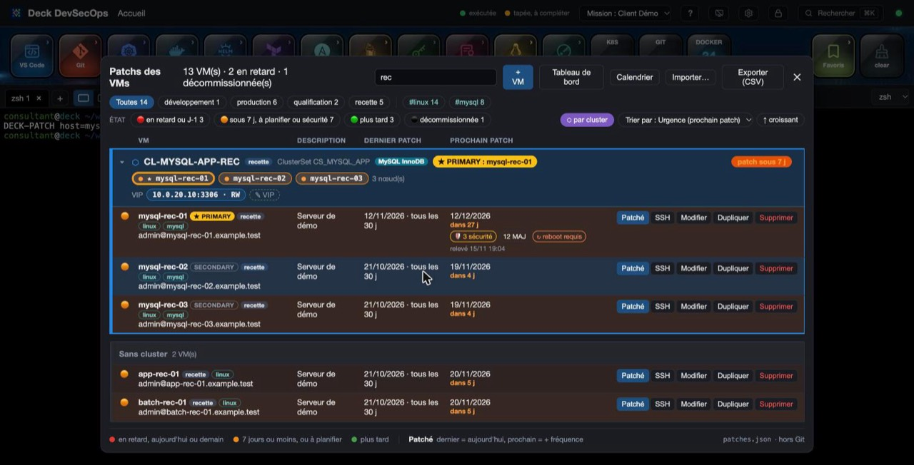

Rather than clicking **Patched** by hand, survey the VM: connect over ssh (bastion included), then the **patch
survey** key (Patches section). It runs a **read-only command, without sudo**, which reads on the VM:

| | RHEL / Rocky (dnf, yum) | Debian / Ubuntu (apt) |
|---|---|---|
| Last patch | date of the last installed package (`rpm -qa --last`) | last change of the packages (`/var/lib/dpkg/status`) |
| Pending updates | `dnf check-update` | `apt list --upgradable` |
| Of which security | `dnf updateinfo list --security` | packages from `-security` |
| Reboot required | `needs-restarting -r` | `/var/run/reboot-required` |

It prints a `DECK-PATCH host=… last=… pending=… security=… reboot=…` line, which the deck reads in the terminal
output. It then updates **the VM the terminal is connected to** (the colored frame; otherwise, the VM whose name
matches the returned host name):

- **last patch** = the date read on the VM, **next patch** recomputed with the frequency; you patch, reboot, survey
  again: no more need for **Patched**;
- **badges** under the date: "🛡 3 security", "12 updates", "↻ reboot needed" or "✓ up to date", and the survey time;
- **pending security updates = orange VM**, even if its next patch is far away: indicator ("sec"), alerts, state
  filter, dashboard and patch order take it into account;
- **reboot required**: badge and watch point, without changing the color;
- a line in the **log** (and thus the intervention report).

**Windows survey** does the same on a Windows server, in a PowerShell session: date of the last hotfix (KB) and reboot
required (the number of pending updates is not surveyed).

The deck never connects to the VM by itself and sends nothing to it: your terminal runs the command, the deck only
reads the marker line. The command prints `DECK-%s … PATCH`: its own text, shown as you type, is never taken for a
result.

## The inventory

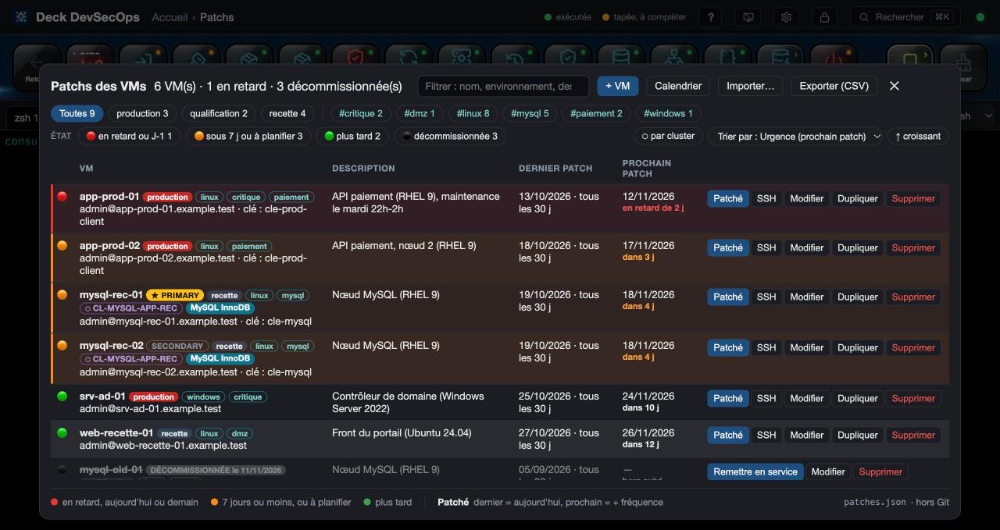

VMs are sorted from most to least urgent, with their environment (production in red), their **tags**, their
description, the last and the next patch.

**Alternating row colors**, the hovered row highlighted in blue, and a **red or orange edge** on the left of urgent
VMs.

**Filters** (under the header), with the number of VMs on each button:

- **environment** (one at a time) and **tags** (they **combine**: **production** + **#critique**);
- **State**: 🔴 overdue or D-1, 🟠 within 7 d or to schedule, 🟢 later, ⚫ decommissioned (one at a time; only the
  states present are offered);
- the **Filter** field also searches the name, host, description and tags.

They all combine; clicking again removes a filter, **All** removes them all.

**Sort**: **Sort by** menu (urgency, name, environment, last patch, next patch) and **↑ ascending / ↓ descending**
button; or click the **VM**, **Last patch**, **Next patch** headings (click again: reversed order, arrow on the
sorted column). The chosen sort is remembered.

For each VM:

- **Patched**: the last patch becomes today and the next one is recomputed with the frequency (e.g. every 30 d); the
  action is recorded in the [log](10-reglages-et-tracabilite.md#action-log);
- **SSH**: types `ssh <host>` in the terminal (without Enter), or `ssh -i <key> <host>` if a key is set for the VM
  (shown under its name: "key: …");
- **Duplicate**: a new VM pre-filled from this one (host, key, environment, tags, dates, frequency, description), with
  the **next free name** (`app-prod-01` → `app-prod-02`, or `-03` if `-02` exists); the name is also replaced in the
  host (`admin@app-prod-01.client.fr` → `admin@app-prod-02.client.fr`). Check the host and the dates before saving;
- **Edit**, **Delete** (two clicks).

**Calendar** (header): the month's due dates and the export to Outlook, see
[Due dates and summary](14-echeances-et-synthese.md).

## Dashboard

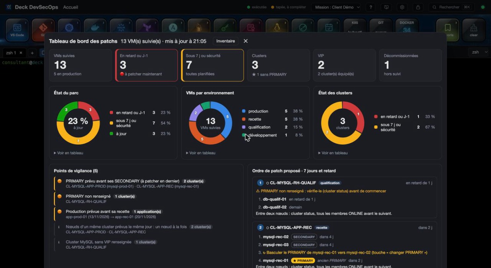

**Dashboard** (inventory header, or ⌘K › "Patch dashboard"): an overview, updated live, of the tracked VMs
(decommissioned ones are counted separately):

- **key figures**: tracked VMs (incl. production), overdue or D-1, within 7 days (and without a date), clusters (and
  those without a PRIMARY), VIPs, decommissioned;
- **three rings** (donut charts) to see the split at a glance: **fleet status** (overdue or D-1, within 7 days, to
  schedule, up to date; in the center, the percentage up to date), **VMs by environment** (one fixed color per
  environment) and **cluster status** (each cluster's most urgent state). Count on the slices, legend with count and
  percentage, detail on hover, **Show as a table**;
- **patches by environment**: one bar per environment, split by status (overdue or D-1, within 7 days, to schedule,
  up to date), with the legend, the count in each segment, the detail on hover (the VMs concerned) and **Show as a
  table** for the figures;
- **next patches over 8 weeks**: number of VMs to patch per week (detail on hover), plus a reminder of overdue VMs
  and VMs without a date;
- **clusters**: environment, node map (status color, gold circle for the PRIMARY, dotted for a decommissioned node),
  nodes, PRIMARY, VIPs and cluster state;
- **most frequent tags**;
- **watch points** and **suggested patch order** (below).

**Everything is clickable**: a tile, a bar segment, an environment, a week, a cluster, a tag or a watch point opens
the **inventory filtered on its VMs**, with a **Selection** filter (e.g. "Selection: ⚠ CL-MYSQL-APP-REC (2)") removed
with ✕ or **All**. With the keyboard: Tab then Enter.

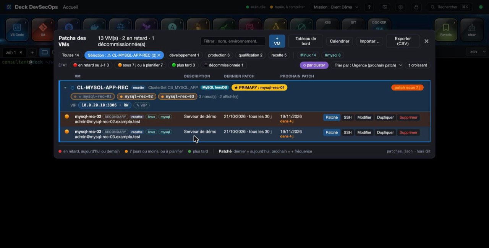

**Inventory** (header) goes back to the VM list.

### Watch points

What can go wrong during a campaign, **grouped by type**: one line per type, with the number of clusters (or VMs)
concerned, the first ones in plain text and all of them on hover; a click opens all their VMs in the inventory. From
most to least serious (🟠 then ℹ):

- 🟠 **production scheduled before its UAT**: matched by name, without the environment words (`app-prod-01` and
  `app-rec-01`, `CL-MYSQL-APP-PROD` and `CL-MYSQL-APP-REC`);
- 🟠 **the PRIMARY scheduled before its SECONDARY nodes**: it is patched last;
- 🟠 **PRIMARY not set** in a cluster of several nodes;
- ℹ **nodes of one cluster scheduled on the same day**: normal for a maintenance window, as long as you patch one node
  at a time;
- ℹ **MySQL cluster without a VIP** set;
- ℹ **reboot required** according to the [survey](#patch-survey-the-vms-real-state).

Being overdue is not a watch point: it is already in the figures, the rings and the patch order.

### Suggested patch order

For VMs **overdue or due within 7 days**, the order to follow, numbered:

- **UAT before production**: development, QA, UAT, then production; within one environment, the most urgent first;
- **one cluster = one block**, with all its tracked nodes (they are patched together; those not due yet are grey):
  **SECONDARY nodes first**, one node at a time, then **↻ switch the PRIMARY** to an already patched node (**switch
  PRIMARY** key of [MySQL Cluster](#mysql-cluster-commands-for-the-js-session)), and **the former PRIMARY last**;
  "cluster status" reminder between two nodes;
- PRIMARY not set: flagged at the top of the block, to check before starting.

**Copy the plan (Markdown)** puts it in the clipboard for a change request, an email or a ticket (numbered steps,
switch command; text in French). A click on a block opens its VMs in the inventory.

## Clusters (MySQL InnoDB Cluster…)

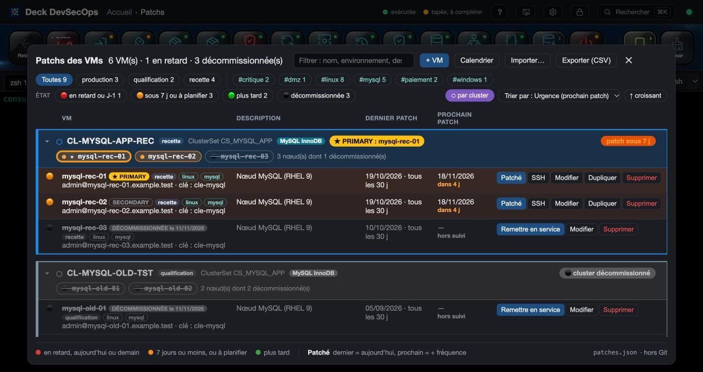

The nodes of one cluster are patched together, and not in just any way: one node at a time, never two environments at
the same time. For each VM, optional fields:

- **Cluster**: the cluster name (e.g. `CL-MYSQL-APP-REC`); clusters already entered are offered;
- **ClusterSet**: the set containing the cluster (MySQL InnoDB ClusterSet);
- **Profile**: *standard* or **MySQL InnoDB Cluster** ("MySQL InnoDB" label; basis for future MySQL-specific
  checks);
- **Role in the cluster**: **PRIMARY** or **SECONDARY** (set by hand). **A single PRIMARY per cluster**: designating
  a new PRIMARY (after a switchover, a `forceQuorum`…) moves the previous one back to SECONDARY, with a message.

The PRIMARY is highlighted: gold **★ PRIMARY** badge on its row, **first** in its cluster, star and gold circle on the
node map, and reminded in the header ("★ PRIMARY: mysql-rec-02"); "PRIMARY not set" otherwise. It is the node to
patch **last**.

**⬡ by cluster** (next to the sort) groups the inventory into **blocks**, one per cluster, framed in the
environment's colors (production red, UAT blue, QA amber, development green):

- **header**: cluster name, environment, ClusterSet, profile, and the cluster's most urgent state;
- **node map**: one dot per node, colored by its patch (🔴 overdue or D-1, 🟠 within 7 d, 🟢 later; detail on
  hover), ★ for the PRIMARY, greyed for a decommissioned node; the number of nodes;
- **click on the header**: collapse the cluster (header and map only) or expand it; remembered;
- the nodes below, sorted by the chosen sort; VMs without a cluster at the end. Outside grouping, the cluster and the
  profile show under the VM name. The **Filter** field also searches the cluster and the ClusterSet.

**Duplicating** a node keeps its cluster, ClusterSet and profile (the copy is SECONDARY): handy to add the next node
(`mysql-rec-03` → `mysql-rec-04`).

## A cluster's VIPs

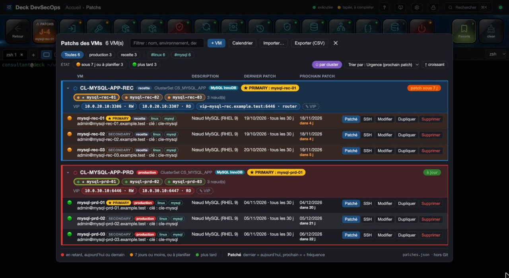

Each cluster can have its **VIPs** (virtual address of the MySQL router, keepalived…), shown in its block's header
(**⬡ by cluster** view), in the environment's colors:

- **✎ VIP**: one VIP per line, `address[:port] [label]`: `10.0.0.10:3306 RW`, `10.0.0.10:3307 RO`,
  `vip-mysql-app.example.test:6446 router`; 10 at most per cluster; IP address (v4 or v6) or host name, without shell
  characters; emptying the list removes the VIPs;
- **click on a VIP**: types `nc -zv <address> <port>` in the active terminal, **without Enter**: connectivity test,
  from the computer or from a terminal connected to a bastion or a VM;
- the **Filter** field also searches the VIP addresses (typing `10.0.30` shows the cluster's nodes).

VIPs are stored in `patches.json` (outside Git) and included in the **full configuration** export; they are not in
the CSV (one line per VM).

## Decommissioned VM

A VM taken out of service stays **in the inventory**, to keep track of it, but is no longer tracked. **Edit ›
Decommissioned VM** (checkbox), or CSV column `decom` (`oui`, `oui 14/11/2026`, `x`…):

- the row is **greyed out**, the name struck through, with a "DECOMMISSIONED on 14/11/2026" badge; it moves **to the
  end of the list**; "not tracked" instead of the patch date;
- it no longer counts for the **indicator** and **alerts**, the **calendar** and the Outlook export, the **summary**,
  nor in the connection lists (**ssh VM**, MySQL nodes);
- if it was the **PRIMARY**, it loses that role;
- its buttons become **Back in service** (tracked again), **Edit** and **Delete**;
- **⚫ decommissioned** state filter; the inventory header counts tracked VMs and decommissioned ones.

**Cluster**: a decommissioned node is greyed and struck through on the node map and no longer counts in the cluster
state ("3 nodes incl. 1 decommissioned"); when **all** nodes are, the cluster turns **grey** ("decommissioned
cluster") and moves to the end of the list.

## MySQL Cluster: commands for the JS session

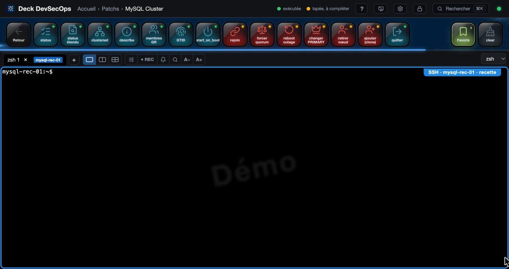

**Patches › MySQL Cluster** gathers the commands to type **inside a `mysqlsh --js` session** (opened with the
**mysqlsh (JS)** key on a node). The deck cannot see that the terminal is in mysqlsh (it runs on the VM): open the
session first, then use these keys.

| Key | Command | |
|---|---|---|
| **status** | `dba.getCluster().status()` | read |
| **extended status** | `dba.getCluster().status({extended: 1})` | read |
| **clusterset** | `dba.getClusterSet().status({extended: 1})` (when status fails: ClusterSet not ONLINE) | read |
| **describe** | `dba.getCluster().describe()` | read |
| **GR members** | `session.runSql("SELECT MEMBER_HOST, MEMBER_STATE, MEMBER_ROLE FROM performance_schema.replication_group_members")` | read |
| **GTID** | `session.runSql("SELECT @@hostname, @@gtid_executed")` (before forcing quorum) | read |
| **start_on_boot** | `session.runSql("SELECT @@group_replication_start_on_boot")` | read |
| **rejoin** | `dba.getCluster().rejoinInstance('<node>')` | ⚠ action |
| **force quorum** | `dba.getCluster().forceQuorumUsingPartitionOf('<node>')` (quorum lost) | ⚠ action |
| **reboot outage** | `dba.rebootClusterFromCompleteOutage()` (complete outage) | ⚠ action |
| **switch PRIMARY** | `dba.getCluster().setPrimaryInstance('<node>')` (e.g. before patching the PRIMARY) | ⚠ action |
| **remove node** | `dba.getCluster().removeInstance('<node>', {force: true})` (rejoin refused, errant GTIDs) | ⚠ action |
| **add (clone)** | `dba.getCluster().addInstance('<node>', {recoveryMethod: 'clone'})` | ⚠ action |
| **quit** | `\q` | |

- **Read** (green dot): run immediately; `session.runSql(…)` avoids switching to `\sql`.
- **Actions** (red, orange dot): **typed without Enter**: you review, complete and confirm.
- **The node** (`<node>`) is picked from a list: the nodes **of the cluster of the VM connected** in the active
  terminal (inventory), as `host:3306`, PRIMARY first, role shown; otherwise every MySQL node of the inventory, or
  free input.

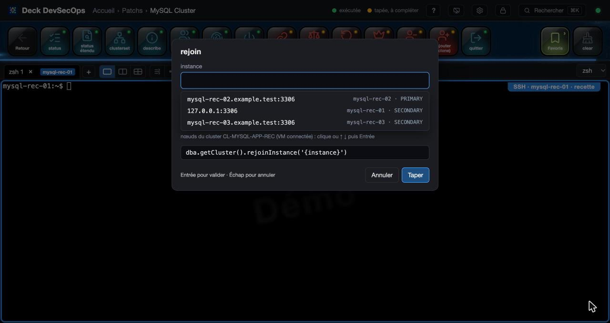

After a **switch PRIMARY** or a **force quorum**, update the role in the inventory (**Edit › Role**): the deck does
not detect it by itself.

## Adding a VM

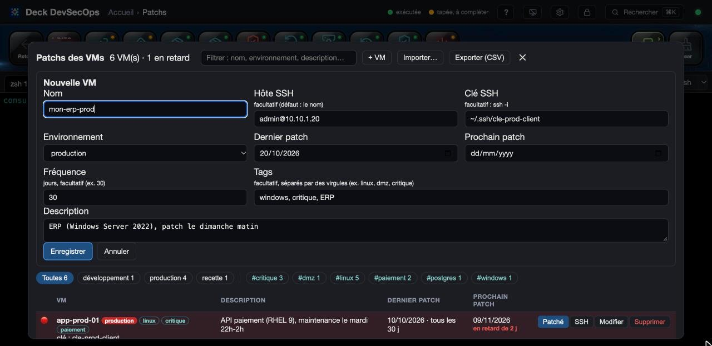

**+ VM**: name (unique), SSH host (optional: the name by default, or `admin@10.0.0.5`), **SSH key** (optional: path
of the private key for `ssh -i`, your keys in `~/.ssh` are offered; shell characters refused), environment, **tags**
(optional, comma-separated: `linux, dmz, critique`; lowercase, 10 at most, tags already used are offered), last
patch, next patch (**optional**: without a date, the VM is "to schedule", in orange), frequency in days, description
(role, OS, maintenance window, contact…). A click anywhere in a date field opens the **calendar**, in the theme's
colors (you can also type the date). If you give the last patch and the frequency, the next one is computed. An error
shows in the form without losing what you typed.

## Importing VMs in bulk

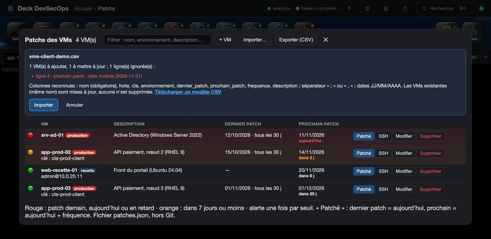

**Import…** loads a **CSV** file (saved from Excel, LibreOffice or an inventory export):

- a header line, then one VM per line; recognised columns, in any order, in French or English: `nom` / name
  (required), `hote` / host, `cle` / key, `environnement` / environment, `dernier_patch` / last_patch,
  `prochain_patch` / next_patch, `frequence` / frequency, `tags` (comma-separated), `cluster`, `clusterset`, `profil`
  / profile (`standard` or `mysql`), `role` (`primary` or `secondary`; a single PRIMARY per cluster, the last one in
  the file is kept and this is reported), `decom` (`oui` or `oui DD/MM/YYYY`: decommissioned VM), `description`; only
  the name is required: a line without a patch date is imported "to schedule";
- separator `;` (Excel in French), `,` or tab, detected automatically; quoted values accepted;
- dates `DD/MM/YYYY` or `YYYY-MM-DD`; environments in French (`production`, `recette`, `qualification`,
  `développement`, `autre`), `prod`, `dev`, `qualif` recognised.

A **preview** shows first: VMs to add, VMs to update (same name), and skipped lines with their number and the reason.
Nothing is written before **Import**. The import **adds or updates, it never deletes** a VM; a backup is made just
before.

- **Download a CSV template** (link in the preview): a file ready to fill in, with two examples.
- **Export (CSV)**: the inventory in the same format, to edit in Excel then re-import.

## Where is the data?

In `patches.json`, **outside Git**, backed up automatically (Settings › Backups) and included in the
[full configuration](10-reglages-et-tracabilite.md#full-configuration-and-update) export, to move from one computer
to another. The indicator only computes from dates: the deck never connects to the VMs by itself; checks are done
with the section's keys, in a connected terminal (pending updates, reboot needed…).
