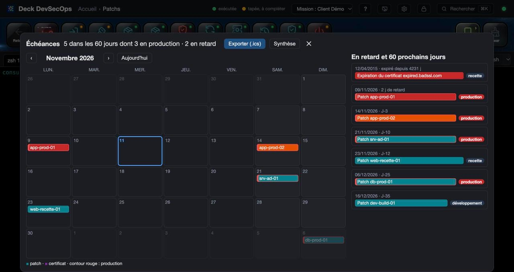
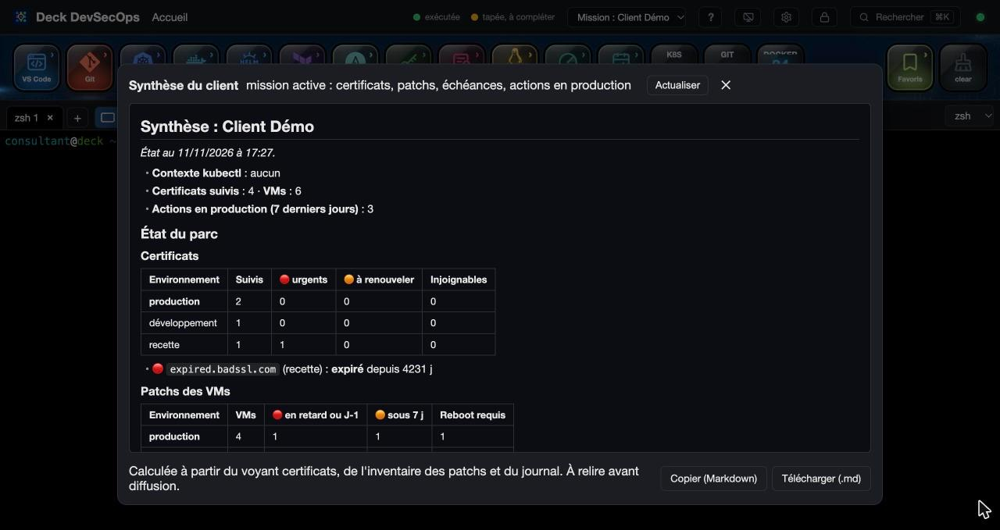
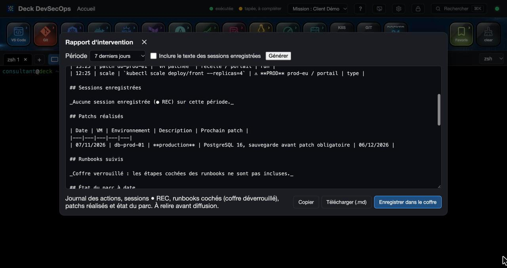

# Due dates and customer summary

[← Contents](README.md)

Two views to follow the active mission's fleet, computed from the **patch inventory** ([VM patches](13-patchs.md)),
the **certificates indicator** ([Missions and certificates](08-missions-et-certificats.md)) and the **log**
([Settings and traceability](10-reglages-et-tracabilite.md)). Nothing is sent anywhere else.

## Due-date calendar

Opening: **Calendar** button of the patch inventory, **Calendar** button of the certificates panel, or **⌘K**
palette › "Due dates".

- **The month**: each next patch (blue-green) and each certificate expiry (purple) on its date, in **red** or
  **orange** when urgent (same thresholds as the indicators). A **red outline** flags production. ‹ › change the
  month, **Today** goes back to the current month.
- **On the right**: what is **overdue**, then the **next 60 days** (D-3, D-10…), with the environment.
- **Click on a patch**: the inventory opens, filtered on that VM.

### Exporting to Outlook or Google Calendar

**Export (.ics)** downloads a calendar file to open with Outlook (double-click) or to import into Google Calendar:

- one all-day event per due date, titled `[PROD] Patch app-prod-01` or `[recette] …`;
- a **reminder 3 days before in production**, 1 day before for the other environments;
- **re-importing updates** the events instead of duplicating them (stable identifier per VM and per certificate).

Your due dates thus show in your work calendar, even with the deck closed. The file only contains names, dates and
descriptions: no key, no secret. Its texts are in French.

## Customer summary

Opening: **Summary** button of the calendar, or **⌘K** palette › "Customer summary". A page ready for a weekly
meeting or a steering committee:

- **context**: mission, current kubectl context (flagged if it is production), number of certificates and VMs;
- **fleet status** per environment: certificates (urgent, to renew, unreachable) and VMs (overdue, within 7 days),
  then the list of **what needs attention**;
- **due dates**: overdue and in the next 30 days;
- **latest production actions** (7 days, from the log).

**Copy (Markdown)** to paste it into an email, Teams or Confluence, **Download (.md)** to keep it, and **Refresh**
after updating the inventory or the certificates. The summary is written in French, for the customer. Review it
before sharing.

## Enriched intervention report

The [intervention report](10-reglages-et-tracabilite.md#intervention-report) also contains:

- **Patches done** during the period: VMs whose last patch falls within the period (**Patched** button), with the
  environment and the next patch, even if the log is disabled;
- **Fleet status as of today**: the same table as the summary, to close the report.
