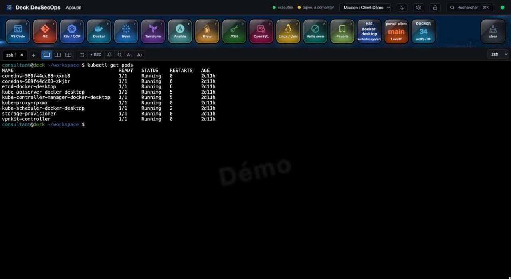
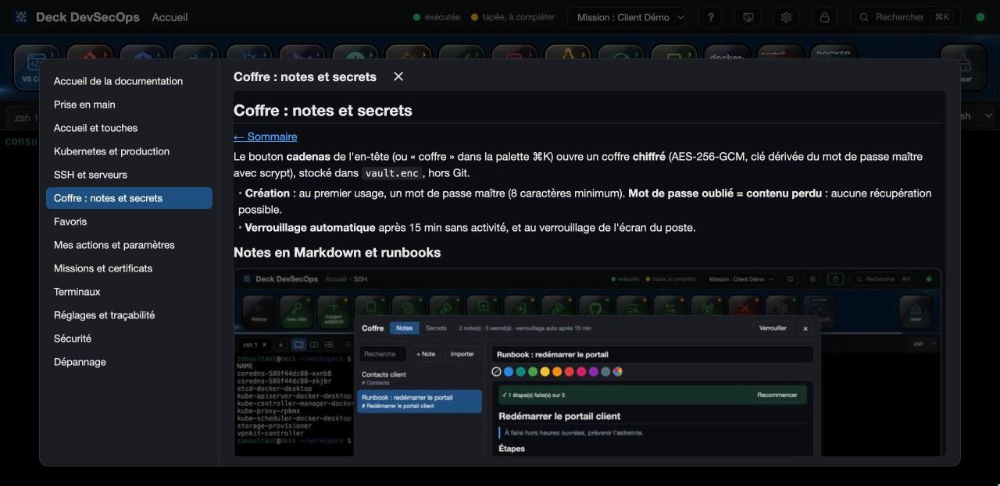

# Web Deck DevSecOps documentation

The DevSecOps consultant's cockpit: keys that type or run the right commands, terminals, an encrypted vault and
safeguards for production. Everything runs **locally**, on macOS and Windows: nothing goes to a cloud.

This documentation is written in Markdown in the repository (*Doc as Code*): it evolves with the code, in the same
commits, and `npm test` checks that every link and every image exists. It also opens **inside the deck**, with the
**?** button in the header (in English when the interface is in English):

> The screenshots show the French interface; the [Settings and traceability](10-reglages-et-tracabilite.md) page shows
> the English one. Version française : [docs/](../README.md).

## Contents

1. [Getting started](01-prise-en-main.md): installation (macOS, Windows without admin rights), running as a service, first start.
2. [Home and keys](02-accueil-et-touches.md): sections, dots, indicators, ⌘K palette, shortcuts.
3. [Kubernetes and production](03-kubernetes-et-production.md): live lists, port-forward, context and namespace, safeguards, diff before applying.
4. [SSH and servers](04-ssh-et-serveurs.md): hosts, keys, tunnels, Ansible on Windows.
5. [Vault: notes and secrets](05-coffre.md): Markdown notes, runbooks, secrets, a secret in a command.
6. [Favorites](06-favoris.md): links per customer, groups, export and import.
7. [My actions and parameters](07-mes-actions-et-parametres.md): your keys, named parameters, live lists, sharing.
8. [Missions and certificates](08-missions-et-certificats.md): per-customer profiles, variables, certificate monitoring, proxy.
9. [Terminals](09-terminaux.md): tabs, layout, broadcast, ● REC recording and player.
10. [Settings and traceability](10-reglages-et-tracabilite.md): appearance, language, log, intervention report, backups, update, diagnostics, screen sharing mode.
11. [Security](11-securite.md): what the deck protects, and how.
12. [Troubleshooting](12-depannage.md): common problems and solutions.
13. [VM patches](13-patchs.md): inventory, dashboard, patch dates, indicator and alerts, clusters and VIPs, decommissioned VMs.
14. [Due dates and summary](14-echeances-et-synthese.md): calendar, Outlook export (.ics), customer summary, enriched report.

To improve this documentation: [Contributing](CONTRIBUER.md).

> The screenshots come from a demonstration deck: customer, hosts, secrets and notes are **fictitious**.
